REDD Abacus SP

User Manualand Software

Degi Harja Sonya Dewi Meinevan Noordwijk Andree Ekadinata Arief Rahmanulloh

---

### Citation

Harja D, Dewi S, van Noordwijk M, Ekadinata A, and Rahmanulloh A.2011.REDDAbacus SPUser Manual and Software. Bogor, Indonesia. World Agroforestry Centre ICRAF, SEARegional Office.89p. Disclaimerandcopyright The World Agroforestry Centre (ICRAF) holdsthecopyrighttoitspublicationsandwebpagesbutencourages duplication, withoutalteration, ofthesematerialsfornoncommercialpurposes. Propercitationisrequired inallinstances. Informationownedbyothersthatrequirespermissionismarkedassuch. Theinformation providedbythe Centreis, tothebestofourknowledge, accuratealthoughwedonotguaranteethe informationnorareweliable foranydamagesarisingfromuseoftheinformation. Websitelinksprovidedbyoursite willhavetheirownpoliciesthatmustbehonoured. The Centremaintains adatabaseofusersalthoughthisinformationisnotdistributedandisusedonlytomeasuretheusefulnessof ourinformation. Withoutrestriction, pleaseaddalinktoourwebsitewww.worldagroforestrycentre.orgon yourwebsiteorpublication.

Contactdetail Degi Harja (d.harja@cgiar.org) and Sonya Dewi (s.dewi@cgiar.org)

World Agroforestry Centre Southeast Asia Regional Office Jl. CIFOR, Situ Gede, Sindang Barang, Bogor16115 POBox161, Bogor16001, Indonesia Tel:+622518625415 Fax:+622518625416 Emai: icrafindonesia@cgiar.org www.worldagroforestry.org/sea Designandlayout Degi Harjaand Tikah Atikah

---

REDD Abacus SP \- Users Manual|i

# How to read the user manual

Thisusermanualhasboththepracticalimplementationandconceptexplanations. Youmay skiptheconceptandreadthepracticalimplementationin Box Frametogetstartedwiththe software.

# Table of Contents

Howtoreadtheusermanual........................................................................................................i

```text
1. General Information..........................................................................................................1
1.1 The REDDAbacus Software..........................................................................................1
1.2 The Minimum Requirement.........................................................................................1
1.3 Softwaredisclaimerandcitation..................................................................................1
1.4 Howtocontact.............................................................................................................2
```

```text
2. Getting Started..................................................................................................................3
```

```text
Windows............................................................................................................................3
Linux..................................................................................................................................4
Mac....................................................................................................................................4
```

```text
3. Overview............................................................................................................................5
```

---

### ii|REDD Abacus SP \- Users Manual

```text
The Basic Methodsfor Estimating Opportunity Cost...............................................................5
Box1.Startingthe Applicationand Create New Project....................................................8
```

```text
4. Spatialand Carbon Stock Input Data.................................................................................9
```

```text
4.1 Landusesystemcharacterization.................................................................................9
1.1 Land Use Transition Eligibility.....................................................................................11
Box2.Land Use System Input..........................................................................................11
1.2 Area Sizeand Spatial Zonation...................................................................................13
Box3.Area Sizeand Zonation Input................................................................................13
1.3 Transition Matrix........................................................................................................14
Box4.Transition Matrix Data Input.................................................................................17
1.4 Carbonstockdata.......................................................................................................18
Timeaveragedcarbonstock (cstock).............................................................................19
Box5.Carbon Stock Data Input.......................................................................................21
```

```text
2. Economic Input Data........................................................................................................22
2.1 Net Present Value.......................................................................................................22
Box6.Cost Benefit Unit Input..........................................................................................26
Box7.Net Present Value (NPV) Input..............................................................................27
2.2 Conversion Cost Benefit.............................................................................................28
Box8.Conversion Cost Benefit Data Input......................................................................29
```

---

REDD Abacus SP \- Users Manual|iii

```text
3. Additional Emission.........................................................................................................30
3.1 Belowground Emission...............................................................................................30
Box9.Belowground Emission Data Input........................................................................31
3.2 Modified Emission......................................................................................................32
Box10.Modified Emission Data Input.............................................................................33
```

```text
4. Output.............................................................................................................................34
4.1 Output Summary........................................................................................................34
4.1.1 Summary..........................................................................................................34
Box11.Output Summary.................................................................................................34
4.1.2 Avoidable Emission..........................................................................................35
Box12.Avoidable Emission.............................................................................................35
4.2 Abatement Cost Curve................................................................................................36
Box13.Abatement Cost Curve........................................................................................38
4.3 Emission Matrix..........................................................................................................40
Box14.Emission Matrix...................................................................................................40
4.4 Cost Benefit Total.......................................................................................................42
Box15.Cost Benefit Total Matrix....................................................................................42
4.5 Opportunity Cost........................................................................................................43
Box16.Opportunity Cost Matrix.....................................................................................43
```

---

### iv|REDD Abacus SP \- Users Manual

```text
5. Simulation........................................................................................................................45
```

```text
5.1 Simulation Scenariowith ABACUS..............................................................................45
Box17.Simulation...........................................................................................................46
5.2 Technicalnotesfor Simulating Scenariounder ABACUS.............................................48
Box18.Transition Probability Matrix...............................................................................53
Box19.Land Use Transition Scenario..............................................................................55
5.3 Simulation Output......................................................................................................57
Box20.Simulation Output Summary...............................................................................57
Box21.Other Simulation Output Matrix.........................................................................59
```

```text
APPENDICES................................................................................................................................61
Appendix1.Exampleof Land Cover Categories....................................................................61
Appendix2.Customizingthe Abacus Chart...........................................................................64
```

```text
a. Settingthedisplayedcomponent.........................................................................64
b. Addingthebarlabel..............................................................................................66
c. Customizingthechartformat...............................................................................67
d. Settingthechartsizeandsavingtheimagesnapshot...........................................70
```

```text
GLOSSARY...................................................................................................................................71
REFERENCES................................................................................................................................82
```

---

REDD Abacus SP \- Users Manual|1

## 1. General Information

### 1.1 The REDD Abacus Software

The REDDAbacussoftwareisavailableontheinternet. Itcanbedownloadedfreelyfrom
http://www.worldagroforestry.org/sea/abacus, andavailable foranyoperatingsystemsuchas

Windows, Linuxor Mac.

1.2 The Minimum Requirement specifications. Theminimumspecifications are:

REDDAbacusisalight application, sothatcanberunincomputersthathavegeneral

- 110MBHarddiskspace (included JVM)
- Memory Capacity256MB

- Goodconditiondesktoporportablecomputer, with anyoperatingsystem

### (Windows, Linux, Mac)

### 1.3 Software disclaimer and citation

The REDDAbacussoftwareisinthepublicdomain. Theusersmayneitherassertpropriety rightstheretonorrepresentthemtoanyoneasotherthan World Agroforestry Centerproduced

### programsandcite REDDAbacus asfollows:

---

2|REDD Abacus SP \- Users Manual 1.4 How to contact

```text
Example: Thisprojectwasanalyzedusingthe REDDAbacussoftware (World Agroforestry
Center2011, Bogor, Indonesia: World Agroforestry Center (ICRAF) Southeast Asia Regional
Programhttp://www.worldagroforestry.org/sea/abacus).
```

Foradditionalinformationandhelp, pleaseseethe REDDAbacusprojectwebsiteat:

http://www.worldagroforestry.org/sea/abacus
Oryoumaycontactthesefollowingaddresses:

- Degi Harja (d.harja@cgiar.org) forsoftwaretechnicalquestions
- Sonya Dewi (s.dewi@cgiar.org) and Meinevan Noordwijk

(m.vannoordwijk@cgiar.org) forsoftwarebackgroundandconcepts

- Andree Ekadinata (a.ekadinata@cgiar.org) for Geographic Information System (GIS)

### analysis

- Arif Rahmanulloh (a.rahmanulloh@cgiar.org) for profitability analysis

Forgeneralinformationpleasecontact: abacus@worldagroforestry.org

---

REDD Abacus SP \- Users Manual|3

## 2. Getting Started

Thereareseveralinstallationpackagesonthewebsite (ordistributed CDpackage) forany

Operating System (Windows, Linuxand Mac). Belowisthegeneralinstruction foreach Operating System: Windows

• Thepackageavailableintwotypes, someincludea Java Virtual Machine (JVM) and somewithout. Forthoseunfamiliarwiththeterm “Java Virtual Machine” we suggestedtodownloadtheoneinclude JVM.Otherwiseyoucanhaveseparate Java installationbeforeinstallingthe REDDAbacussoftware. The Javasoftwarecanbe downloadedfrom: http://www.java.com/en/download/.

• Afterdownloading, extractthezip filethendoubleclickthe.exefile, followthe instructionontheinstallationprocedure. NOTES:

• Ifyouhaveproblemswithinstaller file (sometimeitisnotworkingonsome Windows 7OS), pleasetryusethezippackagewithouttheinstaller.

• Extractthezip file, anduse “run_abacus.bat” fileforrunningtheapplication (double click).

• Youcancreatetheshortcutto “run_abacus.bat” filebyright clickingthefile, select “Sendto”>“Desktop”

---

4|REDD Abacus SP \- Users Manual Linux

- Afterdownloadingopenashelland, cd tothedirectorywhereyoudownloaded
- Attheprompttype: sh ./abacus.bin
- NOTES: youneedtoinstall Java Virtual Machine (version1.6orlater)
- Afterdownloading, doubleclick abacus

theinstaller.

*Mac*

### NOTES:

• Requires Mac OSX10.0 orlater

• Thecompressedinstallershouldberecognizedby Stuffit Expanderandshould automaticallybeexpandedafterdownloading. Ifitisnotexpanded, youcanexpand itmanuallyusing Stuff It Expander6.0orlater.

• Ifyouhaveanyproblemslaunchingtheinstalleronceithasbeenexpanded, make surethatthecompressedinstallerwasexpandedusing Stuffit Expander. Ifyou continuetohaveproblems, pleasecontacttechnicalsupport.

---

REDD Abacus SP \- Users Manual|5

## 3. Overview

### The Basic Methods for Estimating Opportunity Cost

Opportunitycostsrefertothepotentialeconomicgains thatcouldbemadeifcertaintypesof landusechangearenothappening, e.g.aspartofanemissionreductionprogram. Ifthe opportunitycostsarelowrelativetotheamountofemissionreductionthatcanbeachievedby avoidingthiscategoryoflandusechange, itmaybeofinteresttostakeholdersofemission reductiontooffsettheopportunitycostsandmakecontractsthatsecurethatthecarbon remainsstored. Thedifferenceineconomicvalue($/ha), perunitavoidableemission (t CO2e/ha) takesthedimensionsofaprice($/t CO2e).Iftheeconomicvalueofemission reductionelsewhere (e.g.onavirtual ‘carbonmarket’) ishigherthantheopportunitycostsof avoidingemissionsinacertainlandscape, itmaybefinancially attractive for allpartiesto developcontractsthatensurelocalemissionreduction. Severalotherelementsofprice (implementationandmonitoringplustransactioncosts) alsoplayarole, butifopportunitycosts arehigherthangoingmarketprices, discussionsofeconomicincentives forvoluntaryemission reductionwillbeanonstarter. Afurtherdiscussionofbackgroundsisprovidedin Whiteetal., 2010 andvan Noordwijketal., 2011.

Opportunitycostcurvesindicatehowmuchemissionreductionmightbefeasibleatwhatprice. Thebasis for theirconstructingis[1] Thedifferencesineconomicvalue($/ha) and[2] Time-averaged Cstock (t C/ha) ofanytypeof[3] landusechange. Thelandusechangemayhave occurred (iftheopportunitycostisaretrospectiveanalysisofrecenthistory) orisdeemed plausibleinaforwardlookingscenariooflandusechange.

---

### 6|REDD Abacus SP \- Users Manual

REDDAbacuswasdevelopedtoanalyzetheopportunitycostoflandusechangesina landscapeorareawithinaperiodoftimeandgeneratetheabatementcostcurveusing:

a. Alegendthatrepresentslandusechangefromtheperspectiveofeconomic(‘land use) aswellascarbonstorage(‘land cover’) perspectives, andthatallowslanduse changedatatobecompiledbyacombinationoflandcoverchangedetectionand economicconstraints (e.g.labourrequirementsinrelationtohumanpopulation density)(seesection4.1 for furtherexplanationoflandusesystemcharacterization)

b. Typicalcarbonstockdataforeachlegendunit (seesection1.4 for further explanation)

c. Net Present Valueforeachlandusetype, typicallyusingaprivateaccountingstance (Whiteetal., 2010) and/orasocialone (see Table 4formoreinformation)

d. Amatrixoflandusechangevalues, thatareinternallyconsistentandrepresents either historicalchangeoraforwardlookingscenario.

Withtheseinputs, theprogramperformsfoursteps (Figure 1):

a. Convertdifferencesincarbonstocksintoestimatedemissions.
b. Constructatableofopportunitycostsforeverytypeoflandusechangefromthe
  differencesin NPVand Cstocks

c. Determinetheactualemissionsforeachcellinthematrixfromtheareainvolved andtheemissionsperunitarea

d. Presentthecumulativeemissiontotal aftersortingbyopportunitycost

---

REDD Abacus SP \- Users Manual|7

Togetherthesefourstepsleadtoatwodimensionalgraphchartingtheopportunitycostsof avoidingdeforestinglandusechangesagainstvolumeofcarbondioxideequivalentemissions.

### source: van Noordwijketal.2010

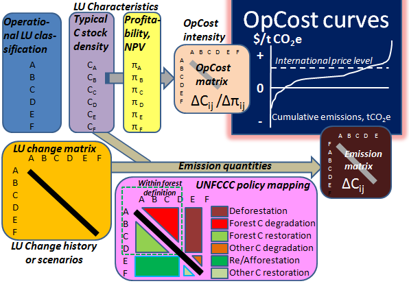

Figure 1 Stepsinderivinganopportunitycost (Op Cost) curvethatrelatesthechangesineconomic profitability (netpresentvalue) andtypicalcarbonstocksoflanduse (LU) systems, toalandusechange matrixthatdescribesthechangesthathaveoccurred (foraretrospective Op Costcurve) ormightoccur (for ascenario Op Costcurve).

Asindicationofafeasible levelofeconomicincentives, aprice levelof USD 5/t CO2e, isusedas default leavingsomespacefortransactionandimplementationcosts (Stern, 2007; Swallowet al., 2007).Theusercaneasilyadjust this price levelandevaluatetheconsequences.

---

### 8|REDD Abacus SP \- Users Manual

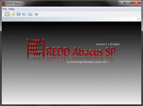

Box 1. Starting the Application and Create New Project How to go: Clickontheapplicationshortcuttostartthe REDD ABACUSapplication.(eachoperatingsystemmayhave differentmethodfor startingtheapplication, see thesection2.Getting Started) Themainwindowswillappearasshownonthe right figure How to do:

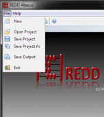

> • Click “File”>“New” onthemenubar
> tocreatenew Abacus Project

> • Youwillbeaskedtodefinelabel for
> thenew Project. Click “Ok”.

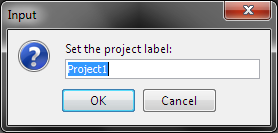

> • Afterdefiningthe Project label, the
> windowwillshowason Figure
> below.

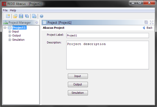

> • Youcandefinethedescriptionof
> theprojectandresetthelabel.

---

REDD Abacus SP \- Users Manual|9

4. Spatial and Carbon Stock Input Data

Spatialand Carbon Stockdataisusedfor calculatingtheestimatedemissionmatrix. Beloware thebriefstepsforpreparingthedataandhowitusedontheapplication.

### 4.1 Land use system characterization

Landusesystemisamixtureoflandcover (e.g., Forest land, Grassland, Wetlands) andlanduse (e.g., Cropland, Settlements) classes. Thecharacterizationoflandusesystemhastobeableto representvariationofcarbonstockandeconomicprofitability. The Informationaboutlanduse systemcharacterizationsareneededtoestimatecarbonstocks, emissions, andremovalsof greenhousegasesassociatedwith Land Use, Land Use Changeand Forestry (LULUCF) activities. Sixbroadcategoriesoflandaredescribedheremaybeconsideredastoplevelcategoriesfor representinglandareaswithinacountry. Thecategoriesareconsistentwiththe Intergovernmental Panelon Climate Change (IPCC) Guidelinesandtherequirementsof Articles 3.3and3.4 ofthe Kyoto Protocol, andmaybefurthersubdividedasdescribedin Appendix1. Thetoplevellandcategoriesfor GHGinventoryreportingare:

• Cropland: this category includes arable and tillage land and agro-forestry systems where woody vegetation falls below the thresholds used for the forest land category, consistent with the selection of national definitions; part of the agroforestry systems falls into this class.

• Forestland: this category includes all land with woody vegetation, usually sub-divided into managed and unmanaged, and further by ecosystem type as specified in the IPCCGuidelines2003 Chapter 3. Agroforests are usually included in this category.

---

10|REDD Abacus SP \- Users Manual definitions. under other categories.

• Grassland: this category includes rangelands and pasture land that is not considered as cropland. The category also includes all grassland from wild lands to recreational areas as well as agricultural and silvi-pastoral systems that do not meet the forest land criterion, subdivided into managed and unmanaged consistent with national

• Otherland: this category includes bare soil, rock, ice, and all unmanaged land areas that do not fall into any of the other five categories. It allows the total of identified land areas to match the national area, where data are available.

• Settlements: this category includes all developed land, including transportation infrastructure and human settlements of any size, unless they are already included

• Wetlands: this category includes land that is covered or saturated by water for all or part of the year (e.g., peatland) and that does not fall into the forest land, cropland, grassland or settlements categories. The category can be subdivided into managed and unmanaged according to national definitions.

When applying these categories, inventory agencies should classify land under only one category to prevent double counting. If a country's land classification system does not match categories (i) to (vi) as described above, it isgoodpracticeto combine or disaggregate the existing land classes of this system of land-use classification in order to use the categories presented here, and to report on the procedure adopted. It is also good practiceto specify national definitions for all categories used in the inventory and report any threshold or parameter values used in the definitions. Where national land classification systems are being changed or developed for the first time, it is good practice to ensure their compatibility with land-use classes (i) to (vi) (IPCC, 2003).

---

REDD Abacus SP \- Users Manual|11

Countries will use their own definitions, which may, of course, refer to internationally accepted definitions, such as those by IPCC, FAO, Ramsar, etc. For that reason no definitions are given here beyondbroad descriptions. In addition, the detailed definitions and the national approach todistinguishing between land uses should be described in a transparent manner. Land-cover types to be classified are determined and defined prior to

the classification processes.

### 1.1 Land Use Transition Eligibility

Thelandusetransition eligibilityisrelatedtoeligibilityofthespecific transition forthe REDD mechanismasdefinedon IPCCGuideline. Theoptionscanbeusedforanalyzingtheoutput basedonwithandwithouttheconsiderationofthetransition eligibility.

Box 2. Land Use System Input How to go:

- Click “Input”>” Spatial&Carbon Stock Data”>” Land Use System” buttonmenuon
- Expandsthetreemenuonthetreemenuframe (ontheleftsidebydefault) on
  “Input”>” Spatial&Carbon Stock Data”>” Land Use System”(highlightthelast child

> themainframe
> Or

### menu)

---

```text
12|REDD Abacus SP - Users Manual
How to do:
```

• Bydefaultthereonlyone Land Use Systemdefined. Youcanaddmorebyclicking the“+”(plus) buttononthetablemenubar. Andclick““(minus) buttonfor removing.

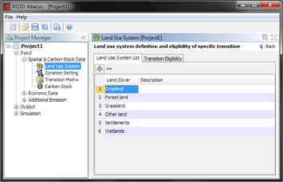

• Renamethelabelaccordingtoyour Land Use Systemdata, andadddescriptionif necessary.

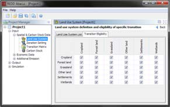

• Youcandocopyandpastemethodforrenamingthelabel (ex.copyfrom MSExcel table)

- Click “Transition Eligibility” tabtodefinetheeligibilityforeachlandusetransition

---

REDD Abacus SP \- Users Manual|13

### 1.2 Area Size and Spatial Zonation

Azonationis Biophysicaland/ornonbiophysical factorsthataffectthevariationofcarbonstock andeconomicprofitabilityinalandscape. Thezonationmayalsoimportantforthepolicy relatedtolanduseplanningstrategy, thusthezonescanalsobeanadministrativebordersor

specificlandusepolicy.

Anexampleofzonationareais “Peat” and “Non Peat” whichrelatedtosoilbiophysicalaspect anddifferentemissionfactorthatmayemittedthosezones. Theotherexamplerelatedto

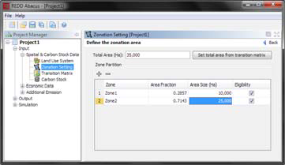

policystrategyis Conservation Area, Production Forest, Settlementetc.

Box 3. Area Size and Zonation Input How to go:

• Click “Input”->” Spatial & Carbon Stock Data”-\>” Zonation Setting” button menu on the main frame Or

```text
• Expands the tree menu on the tree menu frame (on the left side by default) on
“Input”->” Spatial & Carbon Stock Data”->” Zonation Setting” (highlight the last
```

### child menu)

---

14|REDD Abacus SP \- Users Manual 1.3 Transition Matrix How to do:

Timeseriesoflanduse/covermappingasthebasis fortheclassificationschemeisproduced fromsatelliteimageinterpretation. Atleasttwotimestepsthatcoverthespecifiedtimeperiod areneeded. Analysisoflandcoverchangesandthetrajectoriescanbepresentedasa standardisedframeworkcalled ‘Analysisof Land Use/Cover Trajectories’(ALUCT) andisbased oninterpretedandclassified satelliteimages. Thisproceduresappliedin ALUCTwill resultin severaldataneededfortheabatementcostcurveanalysisinputinthis REDDAbacussoftware suchaslandcoverclassification, landcoverchangeandthetransition matrix.

Thetransitionmatrixresultedshowsthequantityoflandusetransitionthatwill affectthe estimateofnationalemissionlevels. Thatiswhyestimatinglandusesystemtransitionis essential for REDD+opportunitycost analysis. Pastchangesarecalculatedbycomparingland usesystemsfromdifferent years. Probablefuturelandusetrajectoriescanbedeterminedby extrapolatingpastchangesand/orbydevelopinglandusemodels (seethesimulationchapter). • By default one Zone was defined. You can add more by clicking the “+” (plus) button on the table menu bar. And click “-“ (minus) button for removing. • You may rename the zone label according to your preference. • You can do copy and paste method for modifying the data on the table (ex. copy

### from MS Excel table)

---

Theentireprocedureof ALLUCTispresentedin Figure2.

Overallworkflowwillenabbleustodosomecrosstabulationoftheetwolandcovermapthat resultinalandusechangeematrix (Table 1).

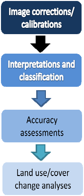

### REDD AAbacus SP \- Users Manual|15


### Figure 2 Overallworkflowin ALUCT

### Source: Widayatietal.2010

---

16|REDD Abacus SP \- Users Manual Table 1 Exampleoflandusechangematrix 2001-2009 Forest (ha) Agroforest/mosaics (ha) Oilpalm (ha) Total2001 Forest 1000 2000 1000 4000 Agroforest/mosaics 500 500 2000 3000 Oilpalm 500 500 2000 3000 Total2009 2000 3000 5000 10000* Fortheanalysisusing REDDAbacusthedatainsidelandusechangematrixthennormalizedto thetotalarea*ofstudyinordertogettheproportionofeachlandusechanges (Table 2). Table 2 Exampleoflandusechangestransitionmatrix 2001-2009 Forest (ha) Agroforestry/mosaics (ha) Oilpalm (ha) Total2001 Forest 0.1 0.2 0.1 0.4 Agroforest/mosaics 0.05 0.05 0.2 0.3 Oilpalm 0.05 0.05 0.2 0.3 Total2009 0.2 0.3 0.5 1 Everyvalueinsidethematrixrepresentsthefraction(%) oflandcoverchangepersubnational zone (Thesumofallcellswithinthisequalto 1) inhectare (ha) unit.

---

REDD Abacus SP \- Users Manual|17

Box 4. Transition Matrix Data Input How to go:

• Click “Input”>” Spatial& Carbon Stock Data”-\>” Transition Matrix” button menuonthemainframe; Or • Expandsthetreemenuon thetreemenuframe (onthe leftsidebydefault) on “Input”>” Spatial&Carbon Stock Data”>” Transition Matrix”(highlightthelast childmenu)

### How to do:

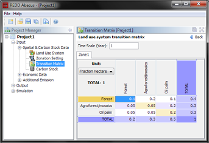

• Fillinthetransitiontimescaleonthetopofthetable • Youcanchangetheunitbyselectingthedropdownmenuonthetoplefttable. By defaulttheunitisin “Fraction Hectare”, theotheroptionisintotal “Hectare” unit. • Youcandocopyandpastemethodformodifyingthedataonthetable (ex.copy from MSExcel table)

• Foreditingonactualhectareunit, selecttheunitdropdownmenuonthetopleftto “Hectare” thenyoucanstart editing.

• Note: youcanleavethetotalareafieldon Zonation Settingemptyanditcanbe filledupautomaticallybythetotalareafromthis table.

---

```text
18|REDD Abacus SP - Users Manual
1.4 Carbon stock data
```

Thestockdifferencemethodbuildsoncarbonstockinventoriesfromlandusechangesto estimatesequestrationoremissions. Carbonstocksineachcarbonpoolareestimatedby measuringthestandingstockofbiomassatthebeginningandattheendoftheaccounting period.

Withineachlandusecategory, Cstockchangesandemission/removalestimationscaninvolve thefivecarbonpoolsthataredefinedin IPCCGuidelines. Forsomelandusecategoriesand estimationmethods, Cstockchangesmaybebasedonthethreeaggregatecarbonpools (i.e., biomass, deadorganicmatterandsoils).Nationalcircumstancesmayrequiremodificationsof thepooldefinitionsintroducedin IPCCGuidelines (IPCC2006). Fourmainstepsof Cstockchangesestimation (Figure 3) are:

a. Estimationoftimeaveraged Cstockofeachlandusesystemstodeterminethe emissionfactors, i.e., differencesbetweentimeaveraged Cstockoforiginallanduse systemswithsubsequenceslandusesystems;

b. Quantificationofactivitydata, i.e., areasofeachtransitionsoflanduse/covertypes;
c. Calculationofemissionestimationbasedontheactivitydatafromstep Band
  emissionfactorsformstep A;

d. Uncertaintyanalysisoftheestimates.

---

REDD Abacus SP \- Users Manual|19

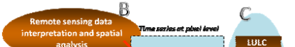

> Figure 3 Fourmainstepsofthe Cstockdifferenceestimationfromlanduse/coverchanges

### Source: Ekadinataetal.2010

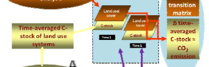

### Time-averaged carbon stock (c-stock)


Theconceptoftimeaveraged Cstockalongwithlandusesystemsareparticularlydeveloped tosuitthecommonpatternsoflandusetrajectoriesinthetropicallandscapeswithadefinite andrelativelyshortrotation. Asanexample, thetraditional shifting cultivationcutacross several differentsequencesoflandcovertypes (e.g., secondaryforestclearedlandannual cropshrubagroforest) anddifferentlanduseandactivities (e.g., nontimberforestproduct gathering, slashingandburningplantingandharvestingofpaddyrubbertapping, rattan harvesting) withinaparticularrotationperiod (e.g., 40years, 60years).Landusesystems 20|REDD Abacus SP \- Users Manual shouldbeabletocapturethetemporaldynamicsof Cstocksuchthatthetypicaloraverage C-stockacrossasystemcanbecalculated, whichisknownastimeaveraged Cstock. Forthepurposeofa REDD+opportunitycostanalysis, avalueoftimeaveragedcarbonstockis neededforeachlanduse. This singlevalueisusedforcarbonaccountingpurposesand comparedwithasinglevalueeconomicindicatorofnetpresentvalue (NPV) isnecessaryfor eachlanduse. Atimeaveragedcarbonstockvalueintegratesthegainsandlossesoveralife-cycleofalanduse (ton/haor Mg/ha).

Timeaveragedcarbonstockdataisnormallyobtainedfrommeasurements. Thebasic assumptionforareabasedcarbonstockaccountingisthecarbonstockchangesoccurred withinandbetweenlandusesystems, eachcharacterisedasafraction (ai) oftotalarea (A)(the stratumweighting) andwithtimedependentcarbonstockdensity Cit (thestratummean).See themanualof RACSA (Hairiah et. al.2010) forfurtherinformationaboutthemethodfor calculatingtimeaveragecarbonstock.

---

REDD Abacus SP \- Users Manual|21

```text
Box 5. Carbon Stock Data Input
How to go:
```

```text
• Click “Input”>” Spatial&Carbon Stock Data”>” Carbon Stock” buttonmenuonthe
mainframe; Or
```

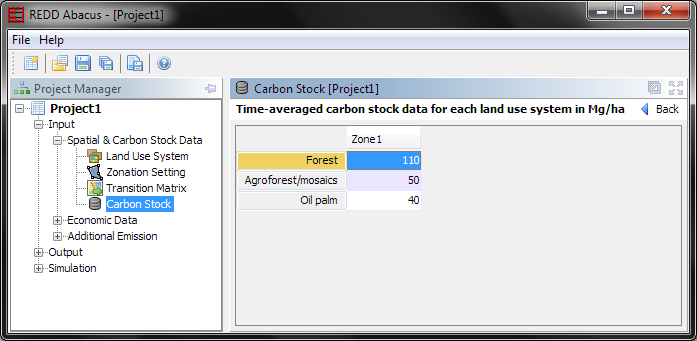

• Expandsthetreemenuonthetreemenuframe (ontheleftsidebydefault) on “Input”>” Spatial&Carbon Stock Data”>” Carbon Stock”(highlightthelast child menu)

### How to do:

• Fillintheassociatedcarbonstockdatatothetable. Theunitison Mg/haor Ton/ha • Youcandocopyandpastemethodformodifyingthedataonthetable (ex.copy from MS Excel table)

---

### 22|REDD Abacus SP \- Users Manual

## 2. Economic Input Data

### 2.1 Net Present Value

Netpresentvalue (NPV) orsometimescalledpresentvalue, isacalculationcommonlyusedto estimatetheprofitabilityofalanduseovermanyyears. NPVtakesintoaccountthetimevalue ofmoney. Sincewaitingfor profitsislessdesirablethanobtainingprofitsnow, the “value” of futureprofitsisdiscountedbyaspecificpercentagerate (Whiteetal.2010).

Therearemanylandusesystemsinvolvingperennialscropsandthusconstitutelongterm investment. NPVmeasuresprofitabilitybyaddressingdifferentlyfuturecostsandbenefit streams. NPVaccumulatesdiscountedrevenueslesscostsoftradableinputsanddomestics

factorsovertheperiodofcalculation.

Tradable inputs consist of fertilizer, fuel and farming tools; while domestic factors are combination of land, labor and management. Costs are defined by multiplying price with the quantity of each items applied during the activities in the period of calculation. The benefits consist of monetary outputs yielded by the land-uses activity along the period of cash flow or analytic horizon. Each land-use activity has different outputs, single or varies \-all outputs should be monetary valued using appropriate prices.

---

REDD Abacus SP \- Users Manual|23

### Thecalculationof NPVisbasedonformulafollows:

### Source: Monkeand Pearson, 1995

Forbriefexplanationof NPVcalculationsee Table3. Table 3 Profitabilityofalandusewithinaperiodoftime (Yn)

### Y1 Y2 Y3 Yn

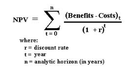

### Total Cost

### 100 50 50 40

### Total Benefit

### 0 0 70 100

Profit (Benefit Cost) 100 50 20 60

---

### 24|REDD Abacus SP \- Users Manual

```text
The NPVistheaccumulationofdiscountedprofitwithinaperiodoftime (Y1......Yn=100+50
+20...+60). This calculationcanalsobedoneby Microsoftexcelusingfollowingsyntax:
```

### “=NPV (discountrate; profitvalue)”

NPVofalanduseactivityovertheperiodofcalculationisappraisedasprofitableif NPVgreater than0.Incontrary, ifthe NPVlessthanzeroiscalledunprofitablebydefinition. Thisdoesnot necessarymeanthattherearenotpositivecashflow. This situationmeansthatitwouldbe moreprofitabletodootherthingswiththeland, laborandcapitalthantodevotethemtothis activity.

Profitabilitycanbeassessedusingbothprivateandsocial values. Ifthecalculationemploys financial pricessoitcalled privateprofitability, whilesocial profitabilityuseseconomicsprices. Thedifferencesbetweenfinancialandeconomicsprofitabilityareshowedon Table 4

---

REDD Abacus SP \- Users Manual|25

Table 4thedifferencesbetweenfinancial (private) andeconomic (social) price

Private Profitability Social Profitability

- Reflectingactualmarkets • Reflectingeconomicefficiency

• atnational scale

• Netreturnreceivedbytheland• Potentialnetreturn useoperator, farmers

• Showthecompetitivenessof • Measurecomparativeadvantage agriculturalsystemsatgiven inagriculturalcommoditysystem currenttechnology, outputvalues, importcost, policy transfer

- Priceused: actualmarketprice • Priceused: worldprice

### (Source: Monkeand Pearson, 1995)

Someofthesourcesofdifferencesinprivateandsocial NPVareonpolicy distortions, ex. Taxes, subsidyandimportrestrictions. Privateandsocial NPVareexpressedin$/hain Abacus. Privateprofitability usuallyusedtoassesscompetitivenessandefficiencyatthefarmgatelevel, thereforeitreflectsreturntolandfortheland’ soperatorside. Social profitabilitymeasures comparativeadvantageinagriculturalcommoditysystem.

---

```text
26|REDD Abacus SP - Users Manual
Box 6. Cost Benefit Unit
Input
How to go:
```

> • Click “Input”-
> \>” Economic Data”-
> \>” Cost Benefit Unit”
> buttonmenuonthe
> mainframe
> Or

• Expandsthetreemenuonthetreemenuframe (ontheleftsidebydefault) on “Input”>” Economic Data”>” Cost Benefit Unit”(highlightthelast childmenu)

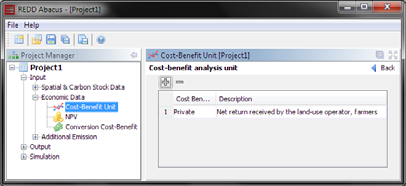

### How to do:

• Bydefaultthe Cost Benefit Unitisonlyfor

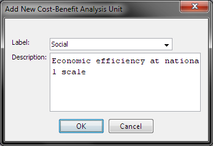

### Private “price”

- Toaddthe Social price, clickon“+”(plus) sign,
  andselectthelabel “Social” ontheadddialog
- Youcandefineotherormore “price” unit for

### thecostbenefitanalysis

---

REDD Abacus SP \- Users Manual|27

```text
Box 7. Net Present Value (NPV) Input
How to go:
```

- Click “Input”->” Economic Data”->” NPV” button menu on the main frame

*Or*

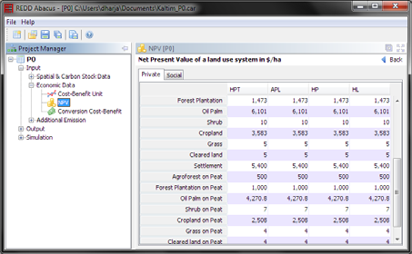

- Expands the tree menu on the tree menu frame (on the left side by default) on

```text
“Input”->” Economic Data”->” NPV” (highlight the last child menu)
```

### How to do:

- Fill in the NPV on the available table for corresponding land use and zone
- You can do copy and paste method for modifying the data on the table (ex. copy
  from MS Excel table)

---

```text
28|REDD Abacus SP - Users Manual
2.2 Conversion Cost-Benefit
```

Conversion Cost Benefitcalculatesthesurplus (benefit) orlosses (cost) occurredduetoland usechangeactivity. Landusechangemaycontributetoeithernegativeorpositiveopportunity costasaresultof NPVdifferences. Thelandconversionitselfmaygenerateadditional profitsor losses, theprofitsaredependonwhethertheinitiallandcoveryield additional benefitwhenit isconvertedtotheotherlandcover, oritisevenextra cost.

This Conversioncostbenefitisoneofanalysisperformedin REDDAbacusinordertogetthe finalvalueoflandusechange NPV.Itrepresentsinperhectareopportunitycostofeachland usechange. Thesurplusorbenefitgeneratedfromlandconversionshouldbeaddedinthenext landuseactivity. Sothatthefinal NPViscalculatedbasedonthefollowingformula:

### NPVfinal=NPVt 2NPVt 1+NPVconversionbenefit

Acommoncasereflectingthebenefitoflandusechangeisincaseofforest. Letusseethe exampleoflandtheconversionfromundisturbedforest intolog off forest. Theestimated profits (expressedin NPV) fromundisturbedforestis$0/haandprofitsfromlogofmixed gardenis$302/ha. Inthiscasethereis$1765/haofadditional benefitfromtheconversionof undisturbedforest intocommercialtype (mixedgarden).This additional benefitofconversion canbeapproachedusingtheprofitfromtimberconcessionactivity (HPH).Basedonprior formulathe NPVfinal willbe$2067/ha($302/ha$0/ha+$1765/ha=$2067/ha).In REDD Abacusthis NPVfinalmustbemultipliedbyareafractionandareatransition (fractionhaor% hafromtotalarea) inordertogetthetotal NPVchangesratiowithintheperiodofanalysis.

---

REDD Abacus SP \- Users Manual|29

Box 8. Conversion Cost-Benefit Data Input How to go:

```text
• Click “Input”->” Economic Data”->” Conversion Cost-Benefit” button menu on the
• Expands the tree menu on the tree menu frame (on the left side by default) on
“Input”->” Economic Data”->” Conversion Cost-Benefit” (highlight the last child
paste method for modifying the data on the table (ex. copy from MS Excel table)
```

> main frame
> Or

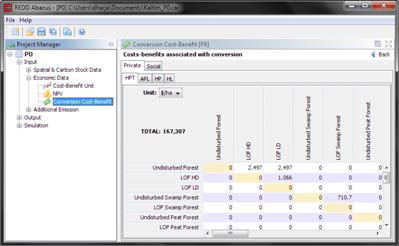

### menu)

### How to do:

• Fill in the associated conversion cost-benefit data to the table.

• The default unit is on $/ha (average dollar per-ha area), however you change it to net value ($) by changing the unit option on top-left of the table to “$”. • You can do copy and

---

### 30|REDD Abacus SP \- Users Manual

## 3. Additional Emission

Theemissionfromothersourceswhichcan’ tbesimplycalculatedfromstockdifferencesis incorporatedhere. Emissionfromthepeat, forexample, mayalsocomefromrootrespiration andpeatdecomposition. Additionalemissionfromthiskindofsourceisincorporatedon “Belowground Emission” matrix. Whileotheradditionalemissionfromabovegrounddynamic whichmaycan’ tbesimplycalculatedfromstockdifferencesisaddedto “Modified Emission” matrix.

### 3.1 Belowground Emission

Belowground Emissionsprovidesawaytoexaminetheeffectsofincluding differentcarbon poolswithinanopportunitycostanalysis. Belowgroundemissioniscalculatedbasedonthe rootemissionandsoilcarbon.

Asmeasurementofrootbiomassisnotsimple (althoughthereisamethodthatusestheroot diameteratstembaseandallometricequations), normallythereareseveraldefault assumptionsfortheshoot: rootratiobasedonavailable literature (Cairnsetal.1997; Mokanyet al.2006).

Soilcarbonconsistsoforganiccarbon, inorganiccarbon, andcharcoal. Inorganicintheformsof carbonateusually existsincalcareoussoils, butinsignificantinneutralandacidsoils. Themain formofthesoilcarbonisthesoilorganiccarbon. Soilorganicmatterdoesnotincludeforest litter. Soilorganiccarbondiffers greatlybetweenpeatsoilandmineralsoil. Themainchangein soilcarboncontentsduetolandusechangeisrarely largerthan 20 Mgcarbonha 1 (IPCC, 1997; Murty, etal.2002), unlessinwetlandconditions. Incaseofthatbelowgroundemissions, whichtypicallyoccurataslowerrate, canbesubstantial, especiallyinpeatlands.

---

REDD Abacus SP \- Users Manual|31

```text
Box 9. Belowground Emission Data Input
How to go:
```

```text
• Click “Input”>” Additional Emission”>” Belowground Emission” buttonmenuonthe
mainframe; Or
```

> • Expandsthetreemenuon
> thetreemenuframe (onthe
> leftsidebydefault) on
> “Input”>” Additional
> Emission”>” Belowground
> Emission”(highlightthelast
> childmenu).See Figure

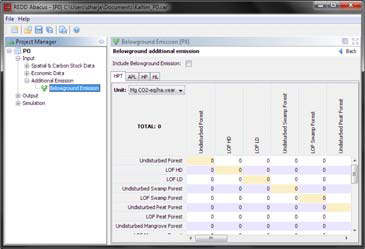

### How to do:

> • Fillintheassociated
> belowgroundemissiondata
> tothetable.

```text
• Thedefault unitison Mg CO2eq/ha.year (averageemission), howeveryouchangeit
tonetemissionperyearbychangingtheunitoptionontopleftofthetableto “Mg
CO2eq/year”.
```

• Youcandocopyandpastemethodformodifyingthedataonthetable (ex.copy from MSExcel table)

---

32|REDD Abacus SP \- Users Manual 3.2 Modified Emission additional “Modified Emission” matrix.

Thesourceofemissioncanbeoutofthetwomentionedabove (carbonstockchangesand belowgroundemission) andtherecouldbebiasedemissioncalculationfromthosetwosources. Hereyoucanmodifytheemissionmatrixbyaddingorreducingthetotalemissioninthis

Theothersourcesofemissionthatcanbeconsideredasemissionmodifierare:

- Emissionfromthefertilization practices.
- Thechangesinrootbiomasswhichsometimeneglected.
- Somelandusechangethatmayrequiretheconsumptionofenergysuchfactory,

transportationetc.

Andtherecouldbealsoothersourceofemissionwhichcanbelocal specificandsignificantly

affectthetotalemission.

---

REDD Abacus SP \- Users Manual|33

```text
Box 10. Modified Emission Data Input
How to go:
```

```text
• Click “Input”->” Additional Emission”->” Modified Emission” button menu on the
main frame
Or
```

```text
• Expands the tree menu on the tree menu frame (on the left side by default) on
“Input”->” Additional Emission”->” Modified Emission” (highlight the last child
menu). See Figure
```

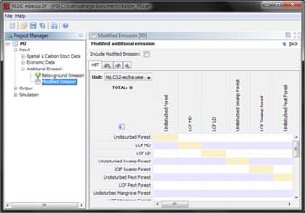

### How to do:

• Fill in the associated modified emission data to the table. • The default unit is on Mg CO2-eq/ha.year (average emission), however you change it to net emission per year by changing the unit option on top-left of the table to “Mg CO2-eq/year”.

> • You can do copy and paste
> method for modifying the data
> on the table (ex. copy from MS
> Excel table)

---

### 34|REDD Abacus SP \- Users Manual

## 4. Output

### 4.1 Output Summary 4.1.1 Summary

```text
Thesummaryoftheoutputareincludingaverageandtotalemissionperyear (in Mg CO2-
eq/Ha. Yearand Mg CO2eq/Year), averageandtotalsequestrationperyear (in Mg CO2-
eq/Ha. Yearand Mg CO2eq/Year), averageandtotal NPV (in$/Ha. Yearand$/Ha).
```

```text
Box 11. Output Summary
How to go:
```

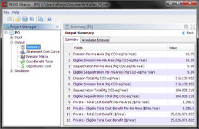

> • Click “Output”>” Summary”
> buttonmenuonthemainframe
> Or

> • Expandsthetreemenuonthe
> treemenuframe (ontheleft
> sidebydefault) on “Output”-
> \>” Summary”(highlightthelast childmenu).See Figure

• Andclick “Summary” tab

### How to do:

• You can do copy method for copying the data to other application (ex. copy to MS Excel table)

---

REDD Abacus SP \- Users Manual|35

### 4.1.2 Avoidable Emission

Theavoidableemissionshowshowmuchemissionreductioncanbeachievedataspecific carbonprice (cost threshold, in$/Mg CO2eq).Seesection 0 for details.

```text
Box 12. Avoidable Emission
How to go:
```

- Click “Output”>” Summary” buttonmenuonthemainframe

*Or*

• Expandsthetreemenuonthetreemenuframe (ontheleftsidebydefault) on “Output”>” Summary” (highlightthelast childmenu).

• Andclick “Avoidable Emission” tab

### How to do:

- Bydefaultthe Cost Thresholdis 5$/Mg CO2eq, youcanchangesthisbyclickingthe

“Update” button, andchangesthevalueontheinputdialog.

• Thetotalavoidableemissionisonthetopofthetable (maychangeswhenthe Cost Thresholdweremodified)

```text
• Youcanchangestheemissionunitineitheraverage (Mg CO2eq/Ha. Year) ortotal
peryear (Mg CO2eq/Year) bychangingtheunitoptionontheright sideof
avoidableemissionvalue.
```

• Thetableisthelistoftheallconversionthatisavoidable (it’ sopportunitycostwas underthecostthresholddefined)

---

```text
36|REDD Abacus SP - Users Manual
4.2 Abatement Cost Curve
```

Anabatementcostcurvecomparesthequantityofpotentialemissionreductionswiththeir costs. Thevertical axisrepresentstheopportunitycostoftheemissions (inmonetaryunitsper t CO2e), andthehorizontal axisdepictsthecorrespondingquantityofreduction (often measuredinmilliont CO2eperyear).

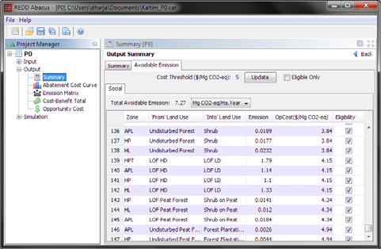

- Toseetheeligibleconversiononly, checkthe “Eligible Only” checkbox
- Youcandocopymethodforcopyingthedataintootherapplication, suchas MS
  Excel table.

---

REDD Abacus SP \- Users Manual|37


Figure 4illustratestheabovecases. Theabatementlevel A*(onthehorizontal axis) isthe quantityatwhichthecarbonprice P*(onthevertical axis) isequalto REDD+costs. Atthis level ofabatement, thecountryreceivesa REDD+paymenttheareaoftherectangle 0P*mn. To reachthis levelofabatement, itfacescostsequaltotheareaundertheabatementcurveupto A*.Thedifferencebetweenthesecostsandthe REDD+paymentareanetbenefittothe country (knownasa ‘rent’ ora ‘producersurplus’).Shouldacountryreducefeweremissionsby lessthanthis level (forexample, abatementlevel A1), itwouldgiveupsomeofthispotential rent (theareaofthetriangletsm).Conversely, ifthecountrychoosesanabatementlevelhigher than A*(forexample, A2), itwillfaceadditional coststhatarenotcompensatedbythe additional REDD+income (areanmwv)(whiteet. al.2010).

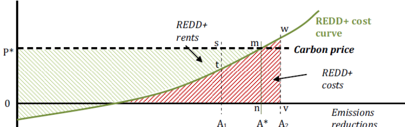

### Figure 4REDD+rentsandcosts


### Source: Whiteetal.2010

---

### 38|REDD Abacus SP \- Users Manual

Thisprovidestheanswerofhowmuchemissionreductioncanbeachievedataspecificcarbon pricethatisconsideredfromtheopportunityanalysisabove. Theanswertothisquestion enablesacountrytoestablishareferenceemissionlevel (REL) abasisfromwhichacountry commitstoreduceemissions. The RELisanimportantcomponentof REDD+preparation because:

• Ifacountryreducesdeforestationtoolittle, itwillmissopportunitiestoincreaseits net REDD+revenues.

*or*

• Itispossibleforacountrytoreducedeforestation ‘toomuch’ thatis, toreduce deforestationatacostthatishigherthanthecompensationitreceivesthrough REDD+.

Itisimportanttonote, however, thatagreementsonpaymentmechanismsandassociated ruleshavenotyetbeenreached (Angelsen2009).Thus, such REDD+rentsmaynotbe structured exactlyasexplainedabove.

```text
Box 13. Abatement Cost Curve
How to go:
```

- Click “Output”>” Abatement Cost Curve” buttonmenuonthemainframe; Or
- Expandsthetreemenuonthetreemenuframe (ontheleftsidebydefault) on

“Output”>” Abatement Cost Curve”(highlightthelast childmenu).

---

REDD Abacus SP \- Users Manual|39

### How to do:

• Thechartshowsanavoidableemission (verticalreddashedlinebydefault) ata specificcarbonprice (costthresholdinhorizontalreddashedlinebydefault)

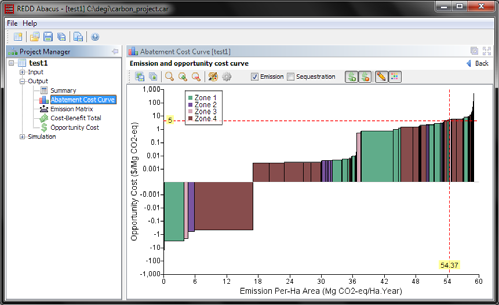

- Eachbarrepresentonelandusetransitionwiththeir Emission (or Sequestration) in
  horizontaldimension, andthe Opportunity Costinverticaldimension
- Thebarsweresortedby Opportunity Costvalueinascendingorder
- Thepositivehorizontallengthofthesortedbarsisthetotalemissionfromall

emittedtransition (andsequestrationonnegativehorizontal axis)

- Thechartisfullycustomize, see Appendix 2 onhowtocustomizethechart

---

```text
40|REDD Abacus SP - Users Manual
4.3 Emission Matrix
```

Emission Matrixshowtheemission (orsequestrationifthevalueisnegative) ofeachlanduse transition. Thevalueiscalculatedfromcarbonstockchangesofthetransition, belowground emission (ifenabled) andmodifiedemission (ifenabled).

```text
Box 14. Emission Matrix
How to go:
```

- Click “Output”>” Emission Matrix” buttonmenuonthemainframe

*Or*

• Expandsthetreemenuonthetreemenuframe (ontheleftsidebydefault) on “Output”>” Emission Matrix”(highlightthelast childmenu).See Figure

### How to do:

• Theframeconsistoffourtabs:

1. Zone Partition: emissionforeachtransitiononeveryzones

2. Net Emission: netemission (totalemission+totalsequestration) foreachland

### usetransition, combinedfor allzones

3. Total Emission: emission (positivevalue) foreachlandusetransition,

### combinedfor allzones

4. Total Sequestration: sequestration (negativevalue) foreachlanduse

### transition, combinedfor allzones

- Thedefaultemissionunitis Mg CO2eq/Ha. Year, youcanchangeittototalemission

---

REDD Abacus SP \- Users Manual|41

unitperyearbychangingtheunitoptiononthetoplefttableto Mg CO2eq/Year

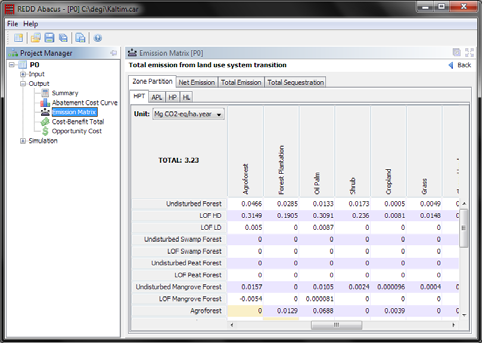

• Youcandocopymethodforcopyingthedataintootherapplication, suchas MS Excel table.

---

```text
42|REDD Abacus SP - Users Manual
4.4 Cost-Benefit Total
iscalculatedfrom NPVchangesandconversioncostbenefit.
```

The Cost Benefit Total Matrixshowthetotalcostbenefitofeachlandusetransition. Thevalue

Box 15. Cost-Benefit Total Matrix How to go:

• Click “Output”>” Cost Benefit Total” buttonmenuonthemainframe Or

• Expandsthetreemenuonthetree menuframe (ontheleftsideby default) on “Output”>” Cost Benefit Total” (highlightthelast childmenu).See Figure

### How to do:

• Theframeconsistoffourtabs:

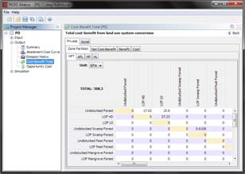

1. Zone Partition: costbenefitvalueforeachtransitiononeveryzones

2. Net Cost Benefit: netcostbenefit (sumofcostbenefitvaluefromallzones) for

### eachlandusetransition

3. Benefit: total positivecostbenefitvaluefromallzonesforeachlanduse

> transition
> transition

4. Cost: totalnegativecostbenefitvaluefromallzonesforeachlanduse

---

REDD Abacus SP \- Users Manual|43

### 4.5 Opportunity Cost

Opportunity Cost Matrixistheopportunitycostforaunitofemissionforeachlanduse transition. Theunitis$/Mg CO2eq.

• Thedefaultcostbenefitunitis$/Ha, youcanchangeittototalcostbenefitunit ($) bychangingtheunitoptiononthetoplefttableto“$”.

• Youcandocopymethodforcopyingthedataintootherapplication, suchas MS Excel table.

```text
Box 16. Opportunity Cost Matrix
How to go:
```

- Click “Output”>” Opportunity Cost” buttonmenuonthemainframe

*Or*

- Expandsthetreemenuonthetreemenuframe (ontheleftsidebydefault) on

“Output”>” Opportunity Cost”(highlightthelast childmenu).

### How to do:

• Theframeconsistoffourtabs:

1. Zone Partition: costbenefitvalueforeachtransitiononeveryzones

2. Net Op Cost: netopportunitycost (sumofopportunitycostvaluefromall

### zones) foreachlandusetransition

---

### 44|REDD Abacus SP \- Users Manual

3. Positive Op Cost: total positiveopportunitycostvaluefromallzonesforeach

### landusetransition

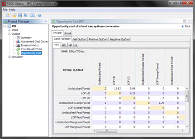

4. Negative Op Cost: totalnegativeopportunitycostvaluefromallzonesforeach

### landusetransition

• Youcandocopymethodforcopyingthedataintootherapplication, suchas MS Excel table.

---

REDD Abacus SP \- Users Manual|45

## 5. Simulation

### 5.1 Simulation Scenario with ABACUS

Originally ABACUSaimstoanalyzetheopportunitycostsofchanginglandusesystemsperunit emittedcarbonfromtheconversionsinthepast. Itisaretrospectiveanalysisthatreflectsthe actualchangesandwhatwouldhavebeentheforgoneopportunities, intermoffinancial benefit, ifthoseconversionswereavoided. Theanalysisprovidesasimple, firstapproximation ofquantitativeindicationoffeasibleavoidableemissionswerethereincentivemechanismsin thepastandthatgiventhatdriversoflandusechangesdonotchangeinthefuture, suchthat thelandusechangesinthefuturearestationaryinratesandtrends, thelevelofavoidable emissionsinthefutureresemblethoseinthepast. Whilethisretrospectiveanalysisisusefulin itselfinprovidingtheentrypointtothediscussiononthefeasibilityofcompensationbased mechanismofclimatechangemitigation actions, theprospectiveanalysis willbeprovidingus withvaluableexanteanalysis forplanningpurposes. Inparticulartheanalysiscanserveasthe maintooltoassessthetradeoffsbetween AFOLUemissionsandlandbaseddevelopment agendatobeasbasisofnegotiationplatformamongmultiplestakeholderstoachieveinclusive, integrativeandinformedlowemissiondevelopmentstrategy. ABACUSfacilitatesthe prospectiveanalysisintwoways:

• Assumingtheprocessoflandusechangesarestationaryinratesandtrends, dueto thefixedamountoflandanddecreasingextentofforests, inabsolutetermsthe conversionandthereforetheemissionswillslowdown. Theprospectiveanalysis shouldthereforetakethis intoaccountinprojectingtheemissionsinthefuture basedonthechangesontheprevioustimestepsandalsotheavoidableemissions givenaparticularthresholdlevelofcompensationperunit CO2 eemission

---

### 46|REDD Abacus SP \- Users Manual

• Divergingfactorsthataffectlandusechanges, e.g., somepolicy interventions, new economicdrivers, changesindemographicstructures, environmentalhazards, may leadtononstationaryprocessoflandusechanges. Inthiscasetherateandtrends oflandusetransitionsmaybealteredeitheruniformlyacrossthelandscapesor variablyamongzoneswithinthelandscapes. Someofthesefactorscanbe anticipatedandcombinedwithplausible policy interventions, somescenarioscanbe developedandformulatedintoalanduseplanpolicywhichfurthertranslated into anticipatedextentandlocationofsomeparticularlandusetransitions. Simulating thesescenariobasedontheexistinglandscapeenablesustoruntheprospective analysisonfutureemissionsandavoidableemissions

Someexamplesofscenarios: haltingdeforestationwithin Conservation Area, establishing oil palmonlyfromshrubsunder Non Forest Land, avoidingconversionofrubberagroforesttooil palm, stoppingconversionsonpeatland.

```text
Box 17. Simulation
How to go:
```

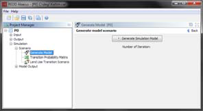

> • Click “Simulation”>” Scenario”-
> \>” Generate Model” buttonmenuon
> themainframe; Or

• Expandsthetreemenuonthetree

menuframe (ontheleftsidebydefault) on “Simulation”>” Scenario”>” Generate Model”(highlightthelast childmenu).See Figure

---

REDD Abacus SP \- Users Manual|47

### How to do:

• Thefigureshowstheframefor startingthe

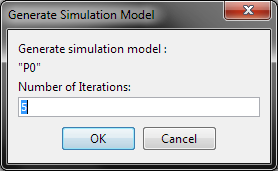

### simulation

> • Clickon “Generate Simulation Button” for
> generatingthescenariomatrix

• Definethenumberofiterationperiodsfor

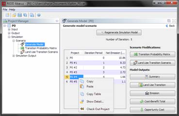

### thesimulation

- Theframewillshowstheoptionsformodifyingthescenario
- Seethenextboxforhowtomodifyingthescenario

TIPS: youcanright clickontheoneoftherows (period), andselect “Check Out Project” to getnewindependent Abacus Projectbasedontheselectedperiod. After, youcando modificationontheprojectandalso startnewsimulationbasedonthatproject independently

---

### 48|REDD Abacus SP \- Users Manual

Oncethescenarioof Reference Emission Level (REL) issetandsimulated, ABACUScanhelp comparingtheprojectedemissionsfromdifferentscenarioswith RELscenario. Thereforehow muchemissionreductioncanbeexpectedinassociationtoparticular lossorgaininprofitsat thelandscapelevelundereachscenariocanbequantified. Theanalysis willhelpthe governmentinfacilitatingthemultistakeholderprocessofdevelopingthelanduseplanningfor lowemissiondevelopmentstrategy (LUWES)(reference).

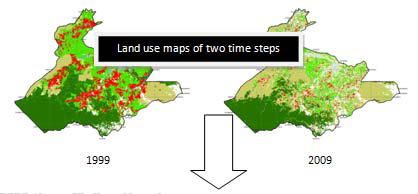

### 5.2 Technical notes for Simulating Scenario under ABACUS

Theprocessoflandusechangestobesimulatedfollows Markov Chain, inwhichtransitionto landuseinthenexttimesteponlydependsonthecurrentlanduseandtheprobabilityof change. Theprobabilityofeachpairoflanduseclassiscompiledas Transition Probability Matrix (TPM), whichinthecaseofstationarylandusechangeprocessderivedsolelyfromthe past Land Use Transition Matrix (LUTM).

---

> REDD Abacus SP \- Users Manual|49

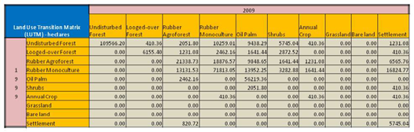

> Land Use Transition Matrix
> (inhectares)

### Land Use Transition Matrix

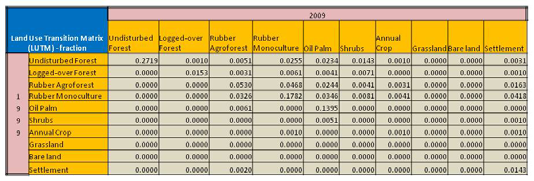

### (fraction)

---

50|REDD Abacus SP \- Users Manual Figure 5 thesimulationprocessesdiagram The Transition Probability Matrixiscalculatedbynormalizeeachrowof Land Use Transition Matrixtosumupto1.Theexisting Land Use (L) in1999 changedto Land Usein2009 through the Transition Probability Matrix (P), ormathematicallyitcanbewrittenasfollows:

### L (t+1)=L (t) x P (t)

### where:


- L (t) isarowvectororfractionlandusesattimet
- P (t) isthe Transition Probability Matrixattimet

```text
Iftheprocessoflandusechangesinthefollowingtimestepsisstationary, the Transition
Probability Matrixisconstantovertime, i.e., P (t+i)=P (t)=P.Otherwise, wecanapplysome
particularscenariosintwoways:
```

### Transition Probability Matrix

---

REDD Abacus SP \- Users Manual|51

• Byalteringtheprobabilityorrateofconversionfromoneparticularlandusetypeto anotherthroughthemodificationof the Transition Probability Matrixataparticular timestep

• Bydeterminingtheconvertedareas (eitherinhectaresorinfraction) inthefuture throughthemodificationofthe Land Use Transition Matrixataparticulartimestep

Asadefault ABACUSalwaysoffertheconstant TPMand L (t+1) basedontheconstant TPM; if wewouldliketosimulatestationaryprocessscenario, thennomodificationisnecessary. However, ifwewanttosimulateparticularscenariosweneedtomodifyeitherthe TPMorthe LUTMinhectaresof LUTMinfraction. Asanillustration, afuturescenarioofenforcementof lawthroughpolicyandactiontohaltdeforestationof Undisturbedforest for this particular landscapecanbedonebyoneofthefollowing:

- Changingthefirstrowofthe TPMfort+1 or P (t+1) to
- Changingthefirstrowofthe LUTMfort+1 or L (t+1) tohaveallthetotalareaof
  Undisturbedforestinthefirstcellandalltherestinthefirstrowzero

```text
• Changingthefirstrowofthenormalized LUTMfort+1 or L (t+1) to1 inthefirstcell
and 0 fortherestofthecellsinthefirstrow
```

---

### 52|REDD Abacus SP \- Users Manual

Scenarioofpolicy thatallowsestablishmentofoilpalmonlyfromshrubscanbecapturedby setting allthecellsin 5 columnto 0 exceptforthatinthe 6row, howeverthoseotherrows

### th th

whichareaffectedbythechangessuchthatthesumisnotequalto 1 anymorehastobe adjusted. Forthepurposeof REDD+, thenfor allforest classesandotherlandusetypesthathas higher Cstockthan Oilpalmshouldperhapsstayastheyare, andthereforeshiftandaddthe numberineachcellinthe 5column (exceptforthe 6row) tothenumberineachassociated

### th th

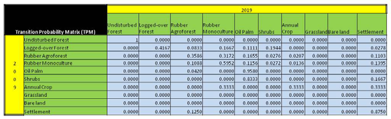

thediagonalcell, e.g., for Loggedoverforest (2 row), changethe 5 columncellto 0 andadd

### nd th

```text
0.1111 tothe 2column, whichbecomes0.4167+0.1111=0.5278.
```

nd

Pleasenotethatmostlikelythescenariosarevariedacrosszones. Inthecaseoflegalzoningof forestasisinthe Indonesiancase, theconservationareasshouldhavedifferentscenariosfrom productionforestandfromother, forinstance. Zonationbasedonsoiltypes, i.e., mineralsoil andpeatlandcouldbeveryinstrumentalinsomeareasin Indonesiawherepeatlandis extensiveandunderthreatwhileweknowthatemissionscausedbylandusechangeson peatlandcouldbemuchhigherthanthoseinmineralsoils.

---

REDD Abacus SP \- Users Manual|53

Box 18. Transition Probability Matrix How to go:

• Click “Simulation”-\>” Scenario”>” Transition Probability Matrix” button menuonthemainframe Or

• Expandsthetreemenuon

thetreemenuframe (ontheleftsidebydefault) on “Simulation”>” Scenario”>
” Transition Probability Matrix”(highlightthelast childmenu).See Figure
- Iftheframeisempty, seehowtogeneratethemodelsection (above)
- Youcanstarttomodifythescenariobyeditingthematrixtable
- Thesumofeachrowvaluesshouldbeequalto 1 (slidethetabletotherighttosee
- Aftertheeditingthe “Update Model” button (abovethetable) willbecomeenabled
- Youshouldclickthe “Update Model” buttonafter finishingthemodificationonthat
- NOTE: ifyouplantomodifythescenarioonmorethanoneperiod, themodification

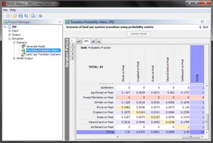

### How to do:

### thetotalofeachrowvalues)

• Selecttheiterationperiodtobemodified

### iterationperiod

---

### 54|REDD Abacus SP \- Users Manual

shouldbestartfromtheearlier iterationperiod (otherwise, themodifiedscenario onthelaterperiodwilloverwrotebythepreviousone)

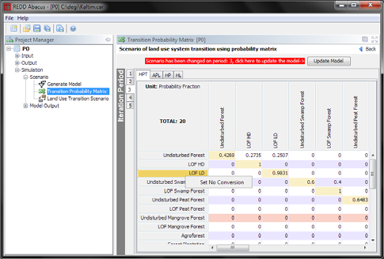

• TIPS: youcanhighlighttherowheaderofalandusesystemandright click, then click “Setnoconversion” tosetthe No Conversionscenariofromthehighlighted landusesystem

---

REDD Abacus SP \- Users Manual|55

Box 19. Land Use Transition Scenario How to go:

• Click “Simulation”-\>” Scenario”>” Land Use Transition Scenario” button menuonthemainframe; Or • Expandsthetreemenuon thetreemenuframe (onthe leftsidebydefault) on “Simulation”>” Scenario”>” Land Use Transition Scenario” (highlightthelast childmenu).See Figure

- Iftheframeisempty, seehowtogeneratethemodelsection (above)

### How to do:

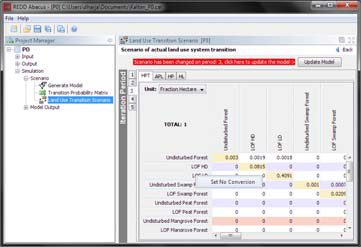

• This scenariomatrixishasthesameroleasthe Transition Probability Matrixabove, exceptthisusingtheactuallandareasize

• Thedefault unitis “Fraction Hectare”, thusthesumofallvaluesinonezonematrix shouldbeequalto1.

• Youcanusetheactualareain “Hectare” unit (changetheunitoptionintopleftof thetable) forthescenario. Butyoumightwanttochangeitbackto “Fraction Hectare” tochecktheconsistency

- Selecttheiterationperiodtobemodified
- Aftertheeditingthe “Update Model” button (abovethetable) willbecomeenabled

---

### 56|REDD Abacus SP \- Users Manual

• Youshouldclickthe “Update Model” buttonafter finishingthemodificationonthat iterationperiod

• NOTE: ifyouplantomodifythescenarioonmorethanoneperiod, themodification shouldbestartfromtheearlier iterationperiod (otherwise, themodifiedscenario onthelaterperiodwilloverwrotebythepreviousone)

• TIPS: youcanhighlighttherowheaderofalandusesystemandright click, then click “Setnoconversion” tosetthe No Conversionscenariofromthehighlighted landusesystem

---

REDD Abacus SP \- Users Manual|57

### 5.3 Simulation Output

Theoutputofthesimulationisprovidedforeachofthetimestepandcanbeexportedeasilyto produceafamilyofcurvesofcumulativeemissionsduringtheperiodofsimulation. These curveswillenableustoreadilycomparetheexpectedemissionreductionsamongdifferent scenariosapplied. Ontheotherhandtheoutputalso offersthetotal profitgeneratedfrom changinglandusesintheoveralllandscape. Thereforeifthe Reference Emission Levelscenario or Business As Usual Scenarioor Historical Projectionhasbeenset, thencomparisonsover emissions, emissionreductionsandopportunitycostsacrossmultiplescenarioscanbemade. Withinourapplicationssofar, onlyfinancialcostbenefitfromlandusesystemsisconsidered, whileitshouldbenotedthattotal REDD+costsaremuchlargerthanthat, someiseasierto quantifythanothers. Thelimitationtofinancial costbenefitonlywithintheexisting applicationsisnotinherenttothesoftwarebutmoretotheavailabilityofdataandanalysis. Anyeconomicopportunitycostandimplementationcostsoranyotherquantifiablecostscould beaccommodatedby ABACUS.

```text
Box 20. Simulation Output Summary
How to go:
```

• Click “Simulation”>” Simulation Output”>” Summary” buttonmenuonthemain frame Or

---

### 58|REDD Abacus SP \- Users Manual

> • Expandsthetreemenuonthe
> treemenuframe (ontheleft
> sidebydefault) on “Simulation”-
> \>” Simulation Output”-
> \>” Summary”(highlightthelast
> childmenu).See Figure

> • Iftheframeisempty, seehow
> togeneratethemodelsection
> (above)

### How to do:

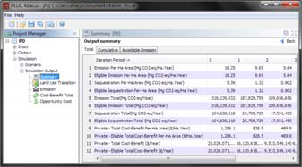

• Theoutputsummaryhasthreetabs:

1. Total: showstheemissionsummary (asintheprojectoutputsummary) per-

### periodofsimulation

2. Cumulative: showstheemissionsummaryincumulativeovertheperiodsof

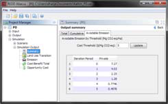

### simulation

3. Avoidable Emission: showstheavoidableemissionovertheperiodwithsingle

### costthreshold (carbonprice)

> • On “Avoidable Emission” tab, youcan
> changesthethresholdbychangingthevalue
> ontheavailable field (topofthetable) and
> click “Update” buttonaftertorefreshingthe
> avoidableemissiontable

---

REDD Abacus SP \- Users Manual|59

```text
Box 21. Other Simulation Output Matrix
How to go:
```

> • Click “Simulation”>” Simulation
> Output” buttonmenuonthe
> mainframe. Or

> • Expandsthetreemenuonthe
> treemenuframe (ontheleftside
> bydefault) on “Simulation”>
> ” Simulation Output”

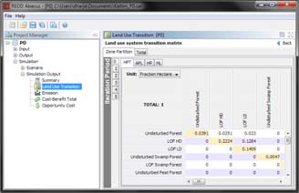

### How to do:

- Theoutputmatrixhasthesameformatasontheprojectoutput, excepttherewere
  separatedintosimulationperiods
- Theoutputmatrixincluding:

o Land Use Transition: showsthechangesonlandusetransitionoverthe simulationperiods (figure xx) o Emission: showsthechangesonemittedemissionperlandusetransition, over the simulationperiods o Cost Benefit Total: showsthechangesontotalcostbenefit perlanduse transition, overthesimulationperiods o Opportunity Cost: showsthechangesonopportunitycostperlanduse transition, overthesimulationperiods

---

REDD Abacus SP \- Users Manual|60

---

REDD Abacus SP \- Users Manual|61

# APPENDICES

### Appendix 1. Example of Land Cover Categories

Thetablebelowshowsanexampleoflandcovercatagoriesandrespectivedefinitionusedin oneof World Agroforestry Studyin Tripaand Batang Torustudysitesin Sumatra, Indonesia. No. Landuse/covertypes Description 1 Undisturbedforest Undisturbed forest isnatural forest cover with dense canopy,

highly diverse speciesandbasal areas. Ithasnologging roads, indicating thatithasneverbeenlogged, atleastnotonalarge scale, and isusually located inareas with rough topography. Canopycoverofundisturbedforestisusually>80%.Insatellite images itisindicated by high value ofvegetation index and infrared spectrum channels and lower value in visible cover and dense canopy. Canopy cover isaround 20-60%. Largetreeswithdiameter>30cmcanbefound.

spectrumchannels.

2 Undisturbed swamp Similarto#1, butlocatedinswampenvironmentandnormally forest with lower vegetation and canopy density compared to

lowlandandmountainousforest.

3 Disturbed/degraded Natural forest area having been disturbed bylogging orother forest timber extraction or fire but stillhas relatively dense tree

4 Disturbed swamp Similarto#3, locatedinswampenvironment. forest

---

### 62|REDD Abacus SP \- Users Manual

5 Rubberagroforest Rubber agroforest ischaracterised by the presence ofrubber

trees mixed with other tree species, which formastand structure similar to secondary forest. Rubber trees typically account for less than 70%ofthe population oftreesabove 10 cm dbh (diameter atbreast height). When the presence of nonrubber trees isdominant and the plot isold enough, the areawillbeveryhardtodifferentiatefromnatural forest.

6 Mixedgarden Mixed garden isatreebased system with more than 30% of

the area consisting ofvarious species oftrees. Mixed gardens areusuallylocatedrelativelyclosetosettlementsorroads.

7 Agroforest Agroforestisdefinedasatreebasedsystemmixedwith crops

and other vegetation witharange of density and diversity lower than but similar tomixed gardens; usually also includes natural understorey vegetation. The location isnot limited by distancetoanyotherlanduse.

```text
8 Estate/plantation Monoculture plantation of tree crops and/or timber. Tree
```

canopycoverisaround 30-50%.

9 Oilpalm Monoculture plantation of oil palm planted by private

companiesandlocalpeople.

10 Coffeeagroforest Mixed cultivation system ofcoffee and shade trees, mostly

```text
managed by local people; normally located close to
settlements.
```

11 Clearedland Area where trees have been cleared, which includes ex-

logging areas or slashedandburned areas prepared for agriculture; vegetation cover isusually herbaceous vegetation and/orgrass.

---

REDD Abacus SP \- Users Manual|63

12 Cropland Cropland isintensively cultivated land and ismostly planted

withannualcropssuchasstaplefood, vegetables, fruit.

13 Shrubs, grass Areadominatedbynonwoodyvegetation, whichisusuallyan

exforest clearing area that undergoes natural secondary regrowth. For old shrubs, thereisalowcoveroftrees, around 5%cover; butnotreeswithdiameter>20cm.

14 Settlement Settlement refers tobuilt area (city orvillage), which includes

```text
road, main road and/or logging road; for rural settlement this
includeshomegardensimmediatelylocatednearthehouses.
```

15 Waterbody Waterbodyreferstoanareacoveredwithwater, forexample,

stream, lake, pond.

16 Nodata Nodatareferstounclassified area, clouds, andshadowarea. Thepeatlandmapwasutilisedtodistinguishbetweenswampforestandlowlandforest, asthe abovegroundcarbonstockdiffersbetweenthesevegetationtypes.

---

### 64|REDD Abacus SP \- Users Manual

### Appendix 2. Customizing the Abacus Chart


Thechartshowstheopportunityanalysisingraphicalcurve. Seesection 7.2 forthechart interpretations. Bydefaultthechartshownasonfigurebelow.

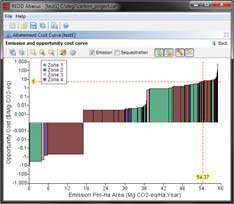

a. Setting the displayed component Youcancustomizethedisplayedvalueelementby selectingthetoolbarshownbelow.

### Thevalueelementsthatcanbeselectedare:

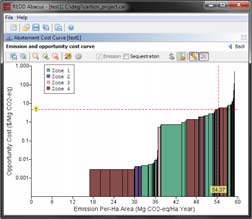

- Emission (positive Xaxis)
- Sequestration (negative Xaxis)
- Positive NPV (positive Yaxis)
- Negative NPV (negative Yaxis)
  Anexampleofvalueelementselectionis
  shownonright:

---


### Thelegendboxdisplaycannbetogglebyselecting thistoolbariconn:


Thethresholdline displaycanbetogglebyselecting thistoolbariccon: Thresholdvalue (anditslinne) canbemodifiedbyright clickingthehorizontal lineandclick “Set Threshold” on popupmenu. Oryoucanddirectlydraggingthehorizontal line (Op Costthreshold) upanddown.


Anotherdisplay settingcannbeaccessedthroughthistoolbar icon: (Display Setting).Thedisplay setting dialogshowstheoptionsfor:


- Whetheryouonlyo wanttodisplaytheeligibleelementts


### only (eligibletrransitionandzones)


• Cost Benefit Unitoptionstodisplayonthechart • The Xaxis unitcanbeselectedeitheraverageemissionn unit (Mg CO2eq/Ha. Year) e ortotalemissionunitperyear (Mg CO2eq/Yeear).Youcanalsocustomizetheunit range.


> • The Yaxis unitcanbeselectedeitheronlogarithmicsccale
> (bydefault) ornormalscale. Youcanalsocustomizethhe
> unitrange.


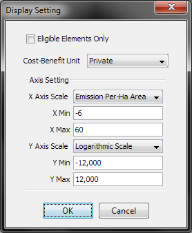

### REDD AAbacus SP \- Users Manual|65

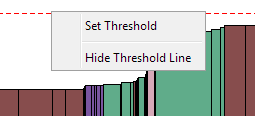

---

### 66|REDD Abacus SP \- Users Manual

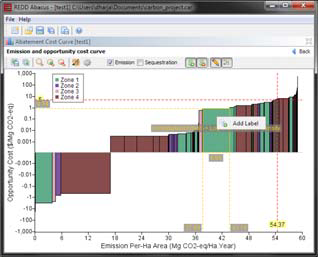

b. Adding the bar label Thecurvebarofthechartrepresentsone landusetransition. Thedimensionis Emission (width) and Opportunity Cost (height).Theinteresting transitioncanbe recognizedeasilyonthechart, eitherthe highestemitterorthebiggestdimension inconjunctionwiththe Opportunity Cost. Toemphasizetheinteresting bar, alabel canbeaddedtothechartforeachofthe bar. Toaddlabel forthebar, highlightthe selectedbarandright click. Clickthepopupmenu “Add Label” asshownonthefigurebelow.

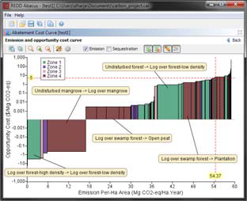

Theaddedlabelcanbedragged, soyoucan composethepositionofthelabelaccording toyourpreference. Thelabelcanbe removedagainbyright clickingthelabel andclick “Remove Label” popupmenu. An exampleofchartwithlabelsisshown below.

---

c. Customizinggthe chart format

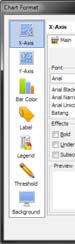


Thechartcolor, line styleaandfontsizecanbecustomizedbyclickingthetoolbaricon:


Theformatsettingdialogshowss theoptionforcustomizedtheforrmatof:


> • XAxis: fontanddlineformatfortheaxis
> titleandnumbbering unit


> • YAxis: fontanddlineformatfortheaxis
> titleandnumbbering unit


• Bar Color: thelegendcolorforthe


### curvebars


• Label: fontanddlabelshapecolor


### format


- Legend: fontsttyleformat
- Threshold: fontandlineformatfor
  horizontalandvertical line


• Background: thebackgroundcoloronly


Allofthesettingpanelsweeresimilar formostofthesametypesetting. Hereisdescribedthe commonsetting thatwasavailable: a Font Youcandefinethefonttyppe, sizeandcolor. Ifnecessarythefonteeffectcanalsobeapplied. On eachtherewerefontpreviewshowingthechangesyoumadeautomatically.


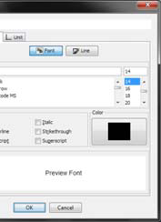

### REDD AAbacus SP \- Users Manual|67

---

68|REDD Abacus SP \- Users Manual Line Lineformatthatcanbemodifiedare: • Line Size: thesizeoflineinpixel • Line Format: theformatdefinitionusingapatternofarrayvalue, separatedby semicolon (ifit’ semptythanstandardlineformatisused).Theruleisasfollows: onevaluei.e.“10”, meansadashedlinewith 10 pixellengthforbothlineand spacesegment twovaluei.e.“10; 5”, meansadashedlinewith 10 pixellengthoflinesegment and 5 pixellengthofspacesegment morethantwovaluei.e.“10; 5; 2; 5”, meansadashedlinewithtwoorderof linespacesegmentwithlengtheach 10 and 5pixel, followedby 2 and 5 pixel dashsegment

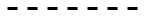

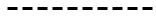

> • Line Color: thecolorofthelinethat
> canbeselectedusingthecolor
> selectordialog


Shape Theshapeformatiscombinationoftheline formatsetting (asdescribedabove) astheformat forborderlineandadditionaloftwofield setting: • Fill Color: thecoloroftheshapefill thatcanbeselectedusingthecolor selectordialog

---

REDD Abacus SP \- Users Manual|69


• Corner: theshapecornerdefinitioninpixel radiusofroundedcorner (set 0 forsharp corner).Theexamplesofcornersettingshownbelow:


### Bar Color


Forthe Bar Colorsetting it’ sdefinedasalegendpatternofshapecolorsetting. Thecolor will representazonationlegendcoloronthechart. Youcandefineasmuchaspossiblethecolor legend, click“+”(plus) signtoaddand““(minus) signtoremovethecolor. Thedefault color patternisavailableasselectabledropdownmenuunderthelegendcolor.

---


### 70|REDD Abacus SP \- Useers Manual


d. Setting thechart size and saving the imagge snapshot


Thechartcanbetransferreedtootherapplicationbyeitherusingthesavedimageorclipboard copymethod. Clickthetooolbaricon (Save Image) forsavingthheimageintocommons imagefileformatsuch JPGG, PNG, GIFor BMP.Togetthebestimaggequality, it’ ssuggestedto saveitin BMPfileformat (bigger (filesize). Thechartcanbecopiedintoclipboardbyclickingthetoolbariconn (Copy Image), andyou canpasteitintootherappplicationsuch MSWords, MSPower Pointoranimageeditor (i.e. Photoshop, Gimpetc) Notes: thechartsnapshotthatwassavedorcopiedisthesamesizze (in pixel) asshowedonthe monitor. Togetbiggerresolutionoffthesnapshot, youcandothezoomingmethodbyclickingtoolbar icon (Zoom).Thezoommdialog willshowstheoptionforzoomingthechartsize. Thechart canberesizedbypercentaageratioorusingthepixel size definitionn. Clickokafterthe modification. Thechartcanbezoomedinandoutdirectly clickinggthetoolbaricon (Zoom In) and (Zoom Out).


---

REDD Abacus SP \- Users Manual|71

GLOSSARY Abovegroundbiomass Biomassabovethesoilsurface: treesandothervegetation.

### Accountingstance

Theviewpointfromwhichcostsandbenefitsarecalculated. Typicalaccountingstancesfor analyzing REDD+initiativesarethatof: anentirecountry, individualgroupswithinacountry, thegovernment, andglobalcommunity.

### AFOLU

Acronymfor Agriculture, Forestryand Other Land Uses. Recommendedby IPCCGuidelines (2006) asanewtermcovering LULUCF (Land Use, Land Use Changeand Forestry) and agriculture. Area Fraction Totaloflandusechangearea (ha) dividedbyatotal sizeofalandscape Belowgroundbiomass Biomassbelowthesoilsurface: plantrootsandothersoil biota. Allometricequation Scaling ruleorequationthatrelatestreebiomass (or similarproperties) tostemdiameter and/ortreeheight.

### Biomass

Thetotalmassoflivingorganismsincluding plantsandanimalsforagivenareausually expressedasdryweightingm 2orkgha1.Organicmatterconsistingoforrecentlyderived 72|REDD Abacus SP \- Users Manual fromlivingorganisms (especiallyregardedasfuel) excludingpeat. Includesproducts, by-productsandwastederivedfromsuchmaterial. Formostecologicalresearchandforthe purposesofthismanual,"biomass"isavegetationattributethatreferstotheweightofplant materialwithinagivenarea. Anothercommonlyusedtermforbiomassis"production"which referstohowmuchvegetationisproducedinanarea.

### Carbondioxideequivalent

Themajorgreenhousegasassociatedwithlandusechangeiscarbondioxide (CO2).Carbonis approximately 46%ofthebiomass (perkilogramofdryweight) storedintreesand 57%ofsoil organicmatter. Whenoneunitoftreecarbonisburnedorotherwisedecomposes, thecarbon combineswithtwounitsofoxygentoproduceoneunitof CO2.Giventheatomicweightsof carbon (12) andoxygen (16), oneunitof Cisequalto3.67 unitsof CO2 ((12+(2*16))/12)=44/12=3.67).Deforestationanddegradationaffecttheproductionother greenhousegases (GHGs) including nitrousoxide (N2O) andmethane (CH4).Theyaremore dangerousgreenhousegases. N20 and CH4have231 and 23 timeshigherglobalwarming potentialthan CO2.Tostandardizetheeffectofdifferentemissions, internationalconvention measuresgreenhousegasloadingintermsof CO2equivalents, representedby CO2eq. Carbonpool Areservoirorsubsystemwhichhasthecapacitytoaccumulateorreleasecarbon. Examplesof carbonpoolsareforestbiomass, woodproducts, soilsandtheatmosphere. Theunitsaremass (kgha 1 or Mgha 1).

### Carbonstocks

Totalcarbonstored (absolutequantity) interrestrialecosystemsataspecifictime, aslivingor deadplantbiomass (aboveandbelowground) andinthesoil, alongwithusually negligible quantitiesasanimalbiomass. Theunitsare Mgha1.

---

REDD Abacus SP \- Users Manual|73

### Carbonstockchange

Thecarbonstockinapoolcanchangeduetothedifferencebetweenadditionsofcarbonand lossesofcarbon. Whenthelossesarelargerthantheadditions, thecarbonstockbecomes smaller, andthusthepoolactsasasourcetotheatmosphere; whenthelossesaresmallerthan theadditions, thepoolsactsasasinktotheatmosphere.

### Carbonsequestration

Theremovalofcarbonfromtheatmosphereandlongtermstorageinsinks, suchasoceanor terrestrialecosystems, throughphysicalorbiologicalprocesses, suchasphotosynthesis. Costs Costrefertothevalueinalternativeusesofthefactorsofproductionusedbyafirm (labour costs, materialcosts, capital costs).Costsmaybefixedorvariable. Countryspecificdata Dataforeither activitiesoremissionsthatarebasedonresearchcarriedoutonsites eitherin thatcountryorotherwiserepresentativeofthatcountry.

### Cropland

Thiscategoryincludesarableandtillage land, andagroforestrysystemswherevegetationfalls belowthethresholdusedfortheforestlandcategory, consistentwiththeselectionofnational definitions Deforestation Mostdefinitionsdescribedeforestationasthelongtermorpermanentconversionoflandfrom foresttononforest. Inanannextoadecisionmadebythe UNFCCCConferenceof Parties (COP), whichservesasameetingofthe Partiestothe Kyoto Protocol, deforestationisdefined as ‘the directhumaninducedconversionofforestedlandtononforestedland’.The FAO definesdeforestationas ‘theconversionofforesttoanotherlanduseorthelongterm 74|REDD Abacus SP \- Users Manual reductionofthetreecanopycoverbelowtheminimum 10%threshold’. Definitions also stipulateminimumtreeheights (FAO: 5minsitu) andminimumareas (FAO: 0.5ha), andthat agriculturemustnotbethedominantuse. Butthedefinitionsofminimumcanopycover, height andareavaryfromcountrytocountry.

### Degradation

Changeswithintheforestwhichnegativelyaffectthestructureorfunctionoftheforeststand orsite, andtherebylowerthecapacityoftheforesttosupplyproductsand/orservices. Inthe contextofa REDDmechanism, forestdegradationresultsinthenetlossofcarbonfromthe ecosystem. Onewaytomeasuredegradationistomeasurethedecrease inthecarbonstockperareaunit (e.g. hectare).

### Discountrate

Aratereflectingatimepreferenceatwhichthevaluefutureprofitsarereducedinamulti-periodmodel. Emissions Thereleaseofgreenhousegasesand/ortheirprecursorsintotheatmosphereoveraspecified areaandperiodoftime (UNFCCCArticle 1.4).

> Forest
> 5

Forestisaminimumareaoflandof0.051.0hectareswithtreecrowncover (orequivalent stockinglevel) ofmorethan1030 percentwithtreeswiththepotentialtoreachaminimum heightof 25metresatmaturityinsitu. Aforestmayconsist eitherofclosedforestformations wheretreesofvariousstoreysandundergrowthcoverahighportionofthegroundoropen forest. Youngnaturalstandsandallplantationswhichhaveyettoreachacrowndensityof 10-30 percentortreeheightof 25metresareincludedunderforest, asareareasnormally formingpartoftheforestareawhicharetemporarilyunstockedasaresultofhuman interventionsuchasharvestingornaturalcausesbutwhichareexpectedtoreverttoforest.

---

REDD Abacus SP \- Users Manual|75

```text
5 Inthecontextofthe Kyoto Protocol, asstipulatedbythe Marrakesh Accords, cf.paragraph 1
ofthe Annextodraftdecision/CMP.1 (Landuse, landusechangeandforestry) containedin
document FCCC/CP/2001/13/Add.1, p.58.
```

### Forestland

Thiscategoryincludesalllandwithwoodyvegetationconsistentwiththresholdsusedtodefine forestlandinthenational GHGinventory, subdividedatthenational level intomanagedand unmanagedandalsobyecosystemtypeasspecifiedinthe IPCCGuidelines.6 Italsoincludes systemswithvegetationthatcurrentlyfallsbelow, butisexpectedtoexceed, thethresholdof theforestlandcategory.

### Good Practice

Asetofproceduresintendedtoensurethatgreenhousegas (GHG) inventoriesareaccuratein thesensethattheyaresystematicallyneitherovernorunderestimatessofarascanbejudged, andthatuncertaintiesarequantifiedandreducedsofaraspossible. Good Practicecovers choiceofestimationmethodsappropriatetonationalcircumstances, qualityassuranceand qualitycontrolatthenational level, quantificationofuncertaintiesanddataarchivingand reportingtopromotetransparency. Grassland Thiscategoryincludesrangelandsandpasturelandthatisnotconsideredascropland. Italso includessystemswithvegetationthatfallbelowthethresholdusedintheforestlandcategory andisnotexpectedtoexceed, withouthumanintervention, thethresholdsusedintheforest landcategory. Thiscategoryalsoincludesallgrasslandfromwildlandstorecreationalareasas wellasagriculturalandsilvopasturalsystems, subdividedintomanagedandunmanaged, consistentwithnational definitions.

### Greenhouse Gases

Areradiatively activetracegasesintheatmospherethattrapinfrared radiation. Theearth absorbsthesun’ sshortwave, ultraviolet radiationandemitslongwave, infrared radiationto 76|REDD Abacus SP \- Users Manual outerspace. Theabsorptionofradiationcauseswarming. Howmuchinfraredenergyescapesto outerspaceisstronglyaffectedbythecompositionoftheearth’ sathmosphere, suchascarbon dioxide (CO2), methane (CH4), nitrousoxides (N2O), andchloroflourocarbons (CFCs) absorb someofthisoutgoinginfrared radiation.

### Groundtruth

Aremotesensingtermreferringtotheactualconditionofthe Earthsurfaceasdeterminedby field visits.

### Intergovernmental Panelon Climate Change (IPCC)

Establishedin1988 asaspecialbodybythe UNEnvironmentalprogrammeandthe World Meteorological Organizationtoprovideassessmentstopolicymakersoftheresultsof ongoing climatechangeresearch. The IPCCisresponsibleforprovidingthescientificandtechnological foundationforthe United Nations Framework Conventionon Climatechange (UNFCCC), primarilythroughthepublicationofperiodicassessmentreports. Kyoto Protocol Anagreementmadein1997 underthe United Nations Framework Conventionon Climate Change (UNFCCC).Annex Icountries thatratify this Protocol (categorizedas Annex Icountries) committoreducingtheiremissionsofcarbondioxideandfiveother GHGs. The Kyoto Protocol nowcoversmorethan170 countries globally, butonly 60%intermsofglobal GHGemissions. Asof December2007, the USand Kazakhstanaretheonlysignatorynationsnottohaveratified the Protocol. Thefirstcommitmentperiodofthe Kyoto Protocol endsin2012, andinternational talksbeganin May2007onthenextcommitmentperiod. Landcover Theclassificationofthebiophysicalsurfaceofthe Earth, comprisingvegetation, soils, rocks, waterbodiesandareasbuiltbyhumans.

---

REDD Abacus SP \- Users Manual|77

### Landuse (LU)

Theclassificationofhumanactivities, occupationandsettlementofthelandsurface; e.g., annualcrops, treecrops, plantations, urban, conservationarea, etc. Landuseclassificationsystem Aframeworkfororganizinglandusesaccordingtocharacteristicsthatdifferentiatethemand makethemunique (forests, agriculture, pastures, urban, etc) Landusesystem (LUS) Dynamiccharacteristicsandinteractionsinactivitiesacrossspaceandtimeonthe Earth surface. Thewordsystemreferstosequentialcyclicalchangesthatarepartofalanduse, such asthecrop/fallowrotationinshifting cultivationsystems. Forthesakeofbrevity, thetermland useisemployedthroughoutthemanual Landscape Anonexactareaofland. Aportionoflandorterritorywhichtheeyecancomprehendina singleview, including alltheobjectsitcontains.

### Leakage

Changesinemissionsandremovalsofgreenhousegasesoutsidetheaccountingsystemthat resultfromactivitiesthatcausechangeswithintheboundaryoftheaccountingsystem. There arefourtypesofleakage: activitydisplacement, demanddisplacement, supplydisplacement, andinvestmentcrowding. Ifleakageoccurs, thentheaccountingsystemwill failtogivea completeassessmentofthetrueaggregatechangesinducedbytheactivity.(IPCCSpecial Reporton Land Use, Land Use Changeand Forestry. http://www.ipcc.ch/pdf/specialreports/spm/srlen.pdf) 78|REDD Abacus SP \- Users Manual Necromassor Dead Organic Matter Theweightofdeadorganisms, usuallyexpressedasgm 2orkgha1.Necromassconsists mainlyofplantlitter. Itisusuallyonthesoilsurfaceorinthesoil, butsomemaytaketheform ofstandingorattacheddeadmaterial. Muchofthetransientorlaginresponsetorapidclimate changebyforestecosystemscanbeestimatedbythedifferencebetweentreeregeneration (tree natality) andtreemortality. Annualnecromassincrementsresultfromindividual tree mortalitywithinstandsandfromlargerscaledisturbanceanddiebackevents (fires, insect infestations, diseaseinfestations, windthrow).Inaddition, asignificantportionofthecarbon stockswhichcomprisestoredterrestrialcarbonofforestandnonforestcommunitiesisinthe formofnecromass. Netemissions In REDD+, netemissionsareestimatesofemissionsfromdeforestationthatconsiderboththe carbonstocksoftheforestbeingclearedandthecarbonstockofthereplacementlanduse. NPV (Net Present Value) Thepresentvalueofaninvestment'sfuturenetcashflowsminustheinitialinvestment. Netreturns. Seeprofit. Opportunitycosts (REDD+) Referstothedifferenceinnetearningsfromconservingorenhancingforestsversusconverting themtoother, typicallymorevaluable, landuses. Opportunitycostanalysisprovidesmoney-basedestimatesofhowdifferentstakeholdersandsectorsofthenationaleconomywouldbe affectedby REDDpoliciesandpayments. Theyareanimportantpartofanationalplanning process.

### Organicmatter (ororganicmaterial)

Matterthathascomefromaoncelivingorganism; iscapableofdecay, ortheproductofdecay; oriscomposedoforganiccompounds.

---

REDD Abacus SP \- Users Manual|79

### Otherland (asalandusecategory)

Thiscategoryincludesbaresoil, rock, ice, andallunmanagedlandareasthatdonotfallintoany oftheotherfive categories. Itallowsthetotalofidentifiedlandareastomatchthenational area, wheredataareavailable.

### Peatland

Peatlandisthelandrichinpartlydecomposedplantremains, withorganic Cof>18%and thicknessof>50cm. Peatlandisintrinsictomanywetlandsaroundtheworld. Thetropicalpeat isabout 1to7 mthickandatplacesitcanbe 20mthick. Moss, grass, herbs, shrubsandtrees maycontributetothebuildupoforganicremains, includingstems, leaves, flowers, seeds, nuts, cones, roots, barkandwood. Peatformsinwetlandsorpeatlands, variously calledbogs, moors, muskegs, pocosins, mires, andpeatswamp. Throughtime, theaccumulationofpeatcreatesthe substrate, influencesgroundwaterconditions, andmodifiessurfacemorphologyofthe wetland. Profit Netreturns, orrevenuesminuscosts.

Reducingemissionsfromdeforestationandforestdegradation (REDDand REDD+)

REDDreferstomechanismscurrentlybeingnegotiatedunderthe UNFramework Convention on Climate Changeprocesstoreduceemissionsfromdeforestationandforestdegradationin developingcountries. REDD+includesenhancementofforestcarbonstocks, thatis,‘negative degradation’ or ‘removals’ onlandclassifiedasforests. Asusedinthisbook, REDD+doesnot includeafforestationandreforestation (A/R).

### Reforestation

Reforestationis ‘the directhumaninducedconversionofnonforestedlandtoforestedland throughplanting, seedingand/orthehumaninducedpromotionofnaturalseedsources, on 80|REDD Abacus SP \- Users Manual landthatwasforested, butthathasbeenconvertedtononforestedland’.Inthefirst commitmentperiodofthe Kyoto Protocol, reforestationactivitieshavebeendefinedas reforestationoflandsthatwerenotforestedon 31 December1989, buthavehadforestcover atsomepointduringthepast 50years.

### Remotesensing

Practiceofacquiringandusingdatafromsatellitesandaerialphotographytoinferormeasure landcover/use. Maybeusedincombinationwithgroundsurveystochecktheaccuracyof interpretation Removals Removalofgreenhousegasesand/ortheirprecursorsfromtheatmospherebyasink. Rent Alsoknownaseconomicrentorproducersurplus. Thevaluethatproducersobtainwhenactual priceexceedstheminimumprice sellers willaccept. Ina REDD+context, rentisthedifferent betweentheinternational priceofcarbonand REDD+costs.

### Sequestration

Theprocessofincreasingthecarboncontentofacarbonpoolotherthantheatmosphere. Itis preferredtousetheterm “sink”.

### Sink

Anyprocess, activityormechanismwhichremovesagreenhousegas, anaerosol, oraprecursor ofagreenhousegasfromtheatmosphere.(UNFCCCArticle 1.8).Notationinthefinalstagesof reportingisthenegative() sign.

---

REDD Abacus SP \- Users Manual|81

### Settlements

Thiscategoryincludesalldevelopedland, includingtransportationinfrastructureandhuman settlementsofanysize, unlesstheyarealreadyincludedunderothercategories. Thisshouldbe consistentwiththeselectionofnational definitions.

### Stratum

Oneofthetwoormoremutuallyexclusivesubgroupsofaframe. Thesingularofstrata. Wetland Landwhereanexcessofwateristhedominantfactordeterminingthenatureofsoildevelop. Zone Biophysicaland/ornonbiophysical factorsthataffectthevariationofcarbonstockand economicprofitabilityinalandscape.

---

```text
82|REDD Abacus SP - Users Manual
REFERENCES
```

Agus F, Hairiah K, Sandra V, van Noordwijk M.2010.Chapter 5 Carbon Measurementof Land Uses: Estimatingthe Opportunitycostsof REDD+Atrainingmanual. Washington, USA: World Bank Institute. Angelsen, A.2008.How Do We Setthe Reference Levelsfor REDDPayments? In A.Angelsen, ed., Moving Aheadwith REDD: Issues, Optionsand Implications. Bogor, Indonesia: Centerfor International Forestry Research (CIFOR).

Angelsen, A.2009.Whatwill REDDcost? Presentation Rainforest Foundation Norway (RFN).18 June. Cairns MA, Brown S, Helmer EHand Bumgardner GA, 1997.Rootbiomassallocationintheworld’ supland forests. Oecologia, 111: 111.

Dewi S, van Noordwijk Mand Ekadinata A.2008.Doescarbonemissiontotheatmospherepay? Abatement costcurvesforthreeprovincesin Indonesia. Bogor, Indonesia. World Agroforestry Centre \- ICRAF, SEA Regional Office .

Ekadinata A, Rahmanulloh A, Pambudhi F, Ibrahim I, van Noordwijk M, Sofiyuddin M, Sardjono MA, Rahayu S, Dewi S, Budidarsono Sand Said Z.2010.Carbon Emissionsfrom Land Use, Land Use Changeand Forestry (LULUCF) in Berau District East Kalimantan, Indonesia. Bogor, Indonesia: World Agroforestry Center (ICRAF) Southeast Asia Regional Program.

Hairiah K, Sitompul SM, van Noordwijk Mand Palm CA.2001.Methodsforsamplingcarbonstocksaboveand belowground. ASBLecture Note 4B.Bogor, Indonesia. International Centrefor Researchin Agroforestry, SEARegional Research Programme.23p.

Hairiah K, Subekti R.2007.Petunjukpraktis Pengukurankarbontersimpandiberbagaimacampenggunaan lahan. World Agroforestry Centre, ICRAFSoutheast Asia. ISBN9793198354.77p. Hairiah K, Dewi S, Agus F, van Noordwijk M, Rahayu S, Velarde SJ.2010.Measuring Carbon Stocks Across Land Use Systems: AManual. Bogor, Indonesia. World Agroforestry Centre (ICRAF), SEARegional Office, Brawijaya Universityand ICALRRD (Indonesian Centerfor Agricultural Land Resources Researchand Development.

---

REDD Abacus SP \- Users Manual|83

Intergovernmental Panelon Climate Change[IPCC], 2003.Good Practice Guidancefor Land Use, Land Use Changeand Forestry. Chapter 3&4

Intergovermental Panelon Climate Change[IPCC].2006.IPCCGuidelinesfor National Greenhouse Gas Inventories. Preparedby The National Greenhouse Gas Inventories Programme, Eggleston H.S., Buendia, L., Miwa, K., Ngara, T.and Tanabe, K.(eds.).Publishedby IGESJapan

Intergovernmental Panelon Climate Change[IPCC].1997.Revised1996IPCCGuidelinesfor National Greenhouse Gas Inventories-Workbook (Volume 2).

Mokany K, Raison JR, and Prokushkin AS, 2006.Critical analysisofrootshootratiosinterrestrialbiomes. Glob. Change Biol.12: 8496.

Monke, E.A.and S.R.Pearson.1995.The Policy Analysis Matrixfor Agricultural Development. Cornell
University Press. Ithacaand London.

Murty D, Kirschbaum MUF, Mc Murtrie RE, Mc Gilvray H.2002.Doesconversionofforesttoagricultureland changesoilcarbonandnitrogen? Areviewoftheliterature. Global Change Biology 8, 105123. Page, S.E., F.Siegert, J.O. Rieley, H.V.Boehm, A.Jayak, and S.Limin, 2002.Theamountofcarbonreleased frompeatandforestfiresin Indonesiaduring1997.NATURE, VOL420, 2002.

Pagiola S, BBosquet.2009.Estimatingthe Costsof REDD+atthe Country Level. Version2.2, Forest Carbon Partnership Facility World Bank. Washington D.C.22p.

Parish, F., A.Sirin, D.Charman, H.Joosten, T.Minayeva, M.Silvius, and L.Stringer (Eds.).2007.Assessment on Peatlands, Biodiversityand Climate Change: Main Report. Global Environment Centre, Kuala Lumpur and Wetlands International, Wageningen.

Sitompul SM, Hairiah K, van Noordwijk Mand Palm CA.2001.Carbonstocksoftropicallandusesystemsas partoftheglobal Cbalance: effectsofforestconversionandoptionsforcleandevelopmentactivities. ASBLecture Note 4A.Bogor, Indonesia. ICRAFSEARegional Research Programme.49p. Stern N.2007.Theeconomicsofclimatechange: The Sternreview. Cambridge, UK: Cambridge University Press.

Swallow BM, van Noordwijk M, Dewi S, Murdiyarso D, White D, Gockowski J, Hyman G, Budidarsono S, Robiglio V, Meadu V, Eka Dinata A, Agus F, Hairiah K, Mbile P, Sonwa DJ, Weise S.2007.Opportunities

---

> 84|REDD Abacus SP \- Users Manual
> 82p.
> USA: World Bank Institute.

for Avoided Deforestationwith Sustainable Benefits: Aninterimreportofthe ASBpartnershipforthe Tropical Forest Margins. Nairobi: ASBPartnershipforthe Tropical Forest Margins. Working Paper42. van Noordwijk M, Tata HL, Ekadinata A, and Mulyoutami E2010.Component D: Oppurtunitycostsof emissionreduction. In: Tata HL, van Noordwijk M, eds. Humanlivelihoods, ecosystemservicesandthe habitatofthe Sumatraorangutan: rapidassessmentin Batang Toruand Tripa. Bogor, Indonesia: World Agroforestry Center (ICRAF) Southeast Asia Regional Office.

van Noordwijk, M., Dewi S., Suyanto, Minang P., White D., Robiglio V., Hoang MH., Ekadinata A, Mulia R., and Harja D.2011.Abatementcostcurvesrelatingpastgreenhousegasemissionstotheeconomicgains theyallowed. Project Report. Bogor, Indonesia. World Agroforestry Centre ICRAF, SEARegional Office.

Wahyunto, Ritung S, Subagjo H.2003.Peta Luas Sebaran Lahan Gambutdan Kandungan Karbondi Pulau Sumatera1990-2002.Bogor, Indonesia: Wetlands International, Indonesia Programand Rapid assessmentin Tripaand Batang Toru117 Wildlife Habitat Canada.

```text
White D, Borner J, Gockowski J.2010.Profitsfrom Land Uses. In: White Dand Minang P, eds. Estimatingthe
opportunitycostsof REDD+Atrainingmanual. Washington, USA: World Bank Institute.
White Dand Minang P, eds.2010.Estimatingtheopportunitycostsof REDD+Atrainingmanual. Washington,
```

Widayati A, Ekadinata A, Johana F, and Said Z2010.Component C: Consequencesoflandusechangefor carbonemissions. In: van Noordwijk M.and Tata HL, eds. Human Livelihoods, ecosystemservicesand thehabitatofthe Sumatraorangutan: rapidassessmentin Batang Toruand Tripa. Bogor. Indonesia: World Agroforestry Center (ICRAF) Southeast Asia Regional Office. World Agroforestry Center. 2009.Analysisof Land Useand Cover Trajectory (ALUCT).